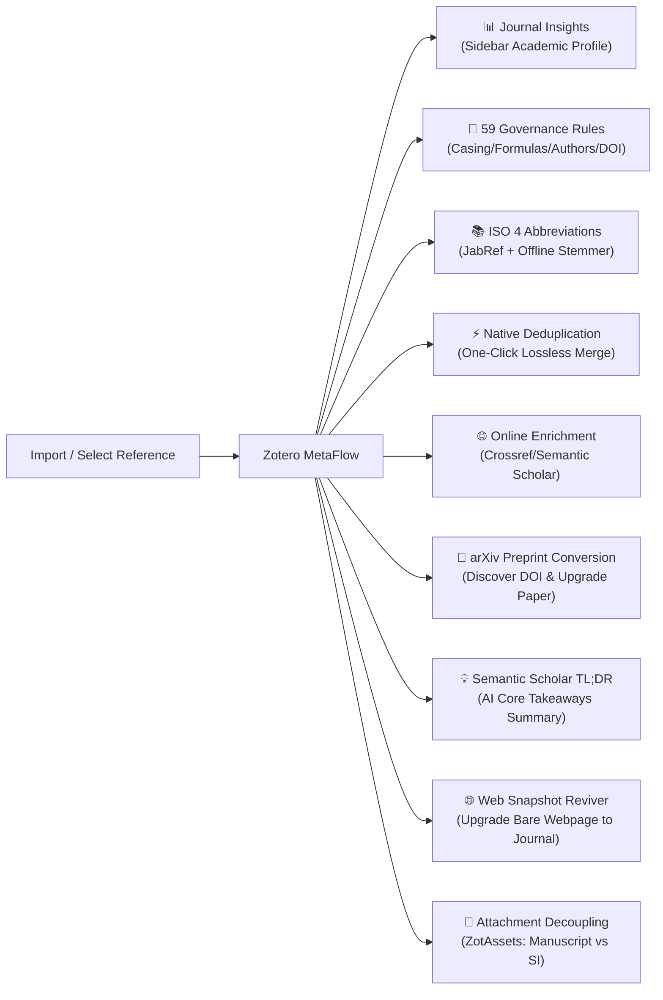

# Zotero MetaFlow

**Deep Reference Metadata Governance · Authoritative Journal Insights · Native Bulk Deduplication · arXiv Preprint Conversion · Semantic Scholar TL;DR Summaries · Web Snapshot Reviver**

_Connect each step of research._

[简体中文](README.md) · [English](README.en.md)

[📦 Installation](#installation) · [✨ Key Highlights](#highlights) · [🛠️ Feature Matrix](#features) · [🚀 Quick Start](#quick-start) · [⚙️ Settings Guide](#settings) · [🛡️ Architecture & Safety](#architecture) · [❓ Troubleshooting & FAQ](#troubleshooting) · [🔗 Flow Series](#series) · [📄 Credits & License](#license)

---

## 📖 Vision & Product Overview

In academic research, item metadata imported from web databases (e.g., Web of Science, IEEE Xplore, PubMed, arXiv, Google Scholar) or captured through web translators and DOI lookups is often flawed: all-caps or all-lowercase titles, destroyed chemical formulas and sub/superscripts, reversed author names, absent ISO 4 journal abbreviations, missing Impact Factor / quartile rankings, and clutter from duplicate entries.

**Zotero MetaFlow** (part of the Zotero Flow Series productivity suite) is engineered for scholars who demand rigorous reference quality. It unifies **59 automated metadata governance rules**, an **offline ISO 4 LTWA journal abbreviation engine**, **61 EasyScholar academic ranking indicators**, and an exclusive **one-click native bulk deduplication workflow**, complemented by an all-new **zero-residual-margin collapsible Journal Insights sidebar panel** to maintain an immaculate, insight-rich research library.

> [!NOTE]
> Zotero MetaFlow is fully standalone and can be used on its own or seamlessly combined with other tools in the Zotero Flow Series (such as RefFlow, MindFlow, ViewFlow, etc.).

---

## ✨ Key Highlights

### 1. 📊 Holistic Journal Insights (Integrated Sidebar Profile)

- **Instant Academic Standing**: Directly embedded in Zotero's right-hand item pane, presenting journal cover badges, normalized full publication names, and standard ISO 4 abbreviations.
- **Multi-Dimensional Authority Coverage**:
  - **Clarivate JCR Quartiles**: Q1 / Q2 / Q3 / Q4;
  - **CAS Journal Ranking (Upgrade & Classic Editions)**: Major / Minor tier partitions and Top Journal certification;
  - **Academic Impact Metrics**: Impact Factor (IF), 5-Year Impact Factor;
  - **Domain-Specific Tiers**: CCF (China Computer Federation) Ranking (Category A / B / C) & Top Conference badges;
  - **Frontier Indexing**: ESI Global Subject Categorization & Nature Index 2026 local recognition.
- **Modern Zero-Residual Collapsible Architecture (v13.0.0+ Breakthrough)**:
  - Completely eliminates residual blank space and rogue container paddings when collapsed; folding **achieves true 0px height and zero margin**, smoothly adapting when expanded;
  - Automatically hides when no data is available (Empty-State Self-Healing) and encapsulates a fine-grained Error Boundary to prevent any host rendering disruption.

### 2. 📄 arXiv Preprint-to-Published Workflow

- **Deep Inspiration from AllanChain/zotero-arxiv-workflow**: Engineered specifically for modern research workflows where papers debut on arXiv before publication in peer-reviewed journals or conferences.
- **Seamlessly Embedded into "Update Metadata" & Sidebar**:
  - Automatically detects arXiv preprints (via `arxiv.org` URL, `archiveID`, or `arXiv:` identifiers);
  - **Zero-Clutter Core Workflow**: Seamlessly integrated into the primary right-click **"Update Metadata"** command. It activates dynamically **only when an unconverted preprint is detected**; ordinary journal/conference papers never trigger preprint prompts, avoiding extra redundant context menu items;
  - **User-Configurable in Settings**: Easily toggled via the "Update Metadata" pipeline settings, putting users fully in control of automatic preprint conversion;
  - **Dedicated Sidebar Card**: Displays a dedicated **arXiv Preprint Card** in the right-hand Journal Insights panel, complete with an official link and a prominent **"⚡ Check & Convert to Published Version…"** action button.
- **Dual Safe Conversion Modes**:
  - **In-Place Seamless Upgrade**: Queries the arXiv Atom API and CrossRef for published DOIs and publication volume/issue/pages; upgrades the itemType to `journalArticle` or `conferencePaper` while **preserving 100% of PDF attachments, highlights, annotations, notes, and tags**, appending the original arXiv ID to `Extra` for auditing;
  - **Create Related Version**: Retains the preprint item and generates a new journal entry with bidirectional native Zotero relations.
- **Provenance Badge**: Converted papers proudly display an **"arXiv Converted"** badge in their Journal Insights header for transparent provenance.

### 3. ⚡ One-Click Native Bulk Deduplication

- **Seamless Zotero Integration**: Directly integrated into Zotero's native "Duplicate Items" collection view, providing a global one-click batch merge action in the upper-right utility area.
- **Fail-Safe Global Merging Policy**:
  - **Single Global Authorization**: Bypass tedious group-by-group manual confirmation with one secure global authorization;
  - **Master Item Selection**: Intelligently designates the earliest added item as master, adopting the most established metadata;
  - **Missing-Field Inheritance**: Automatically inherits and completes empty fields from secondary duplicates so no data is lost;
  - **Full Asset Preservation**: All attachments (PDFs, snapshots), notes, tags, collection links, and native Undo history are preserved via Zotero's native merge transactions.
- **Non-Intrusive Progress Feedback**: Delivers updates via native bottom-right toast notifications with cancellation support.

### 4. 💡 Instant Semantic Summaries: Semantic Scholar TL;DR Core Takeaways

- **Inspired by syt2/Zotero-TLDR with Deep Native Evolution**: Solves the common academic pain point of wading through dense abstracts without grasping the paper's core contribution. MetaFlow extracts 1–2 sentence AI summaries (Too Long; Didn't Read) powered by Semantic Scholar.
- **Embedded into the "Update Metadata" Workflow**:
  - Automatically queries and retrieves key arguments for items with DOI, arXiv ID, or PMID when running "Update Metadata";
  - **Flexible Storage Targets (User-Configurable)**:
    - **Dedicated Child Note (Recommended)**: Idempotently creates or updates a clean HTML child note (`💡 TL;DR Core Takeaways (Semantic Scholar)`) without cluttering publication metadata;
    - **Extra Field**: Appends `TLDR: ...`, enabling direct display in library table columns;
    - **Dual Mode (Child Note + Extra)**: Delivers both instant table visibility and detailed note archiving;
    - **Abstract Self-Healing**: Fills empty `abstractNote` fields when missing.
- **Dedicated Library Column "TL;DR Takeaway (撷论)"**: Directly registers a custom column in Zotero's library list view header menu (`ItemTreeManager`), displaying the distilled core contribution inline across library entries with instant real-time refresh!
- **Integrated Sidebar Highlight**: Displays a dedicated `💡 Core Takeaways (TL;DR)` card in the right-hand Journal Insights panel for instant reading comprehension.

### 5. 🌐 Web Snapshot & Blog Reviver ("One-Click Revive")

- **Inspired by Snapshot Reviver & Metadata Hunter**: Solves the core frustration where browser clippings of journal papers, Nature News articles, or academic blogs are captured as bare `webpage` items—lacking authors, publication years, volume, issue, pages, or DOIs, with only an empty URL and truncated title.
- **Three-Tier Scholarly Fingerprint Sniffing (`discoverSnapshotIdentifiers`)**:
  - **Deep URL Parsing**: Extracts clean DOIs, Nature/Nature News paths (`10.1038/d41586-...`), arXiv IDs (`2403.12345`), and PubMed PMIDs/PMCIDs;
  - **Snapshot HTML `<head>` Probing**: Automatically parses `<meta name="citation_doi">`, `<meta name="dc.identifier.doi">`, `<meta name="citation_arxiv_id">`, `<meta name="citation_pmid">`, and `<link rel="canonical">` from downloaded snapshot heads while strictly filtering out body reference DOIs;
  - **Live Page Head Fallback**: Sniffs online page heads when local snapshots are absent.
- **Scholarly Lookup & Item Upgrade**:
  - Queries Crossref and Semantic Scholar to retrieve complete bibliographic metadata;
  - Promotes bare `webpage` or `blogPost` items to standard `journalArticle` or `preprint` with all authors, publication details, and volume/issue/pages populated.
- **Provenance Preservation**:
  - Retains original webpage titles and URLs while writing provenance details (`MetaFlow revived from: ...`) into the `Extra` field.
- **Seamless Pipeline Integration & User-Configurable**:
  - Embedded into the primary "Update Metadata" workflow;
  - Configurable via Preferences under Workflow Settings ("Revive Web Snapshots & Blog Posts").

### 6. 📑 Manuscript & Supplementary Information (SI) Role Decoupling & Safe Renaming (ZotAssets Engine)

- **Solving the Multi-Attachment Pain Point of Top Journals**:
  - In premier scientific journals (such as _Nature_, _Science_, _Cell_, _JACS_, _Angewandte Chemie_), crucial experimental procedures, characterization spectra (NMR, XRD, HRMS), synthetic routes, and raw datasets are housed inside multi-hundred-page **Supplementary Information (SI)** files;
  - Standard Zotero importing or web grabbing frequently labels all PDFs with nondescript random hashes (e.g. `41586_2023_Article_BF_moesm1_ESM.pdf`) and generic "Full Text PDF" titles in the item tree, making locating critical experimental details confusing and error-prone.
- **Intelligent Dual-Engine Role Classification**:
  - **Publisher Filename Pattern Matching**: Built-in comprehensive heuristics covering major publishers (Nature, Science, Wiley, ACS, RSC, Springer, Elsevier) for SI filename patterns (`suppinfo`, `moesm`, `esi`, `sm`, `appendix`, `supporting information`, etc.);
  - **PDF First-Two-Pages Structure Probing**: Leverages modern Gecko / PDFWorker engines to inspect text on opening pages, capturing structural markers such as `Figure S1`, `Table S2`, `Scheme S1`, and `Supplementary Information`;
  - **Parent Item Cross-Validation**: Cross-validates DOI, title, and publication metadata to identify the true primary **Manuscript**.
- **Cross-Platform Safe Renaming & Custom Templates**:
  - **Custom Rename Template**: Provides an accessible template input in preferences, supporting `{author}` (first author), `{year}` (publication year), `{title}` (item title), and `{role}` (role tag: Main / Supplement) formatting;
  - **Rigorous Filesystem Sanitization**: Strips illegal path characters (`: / \ < > * ?`) across Windows/macOS/Linux, guards against Windows reserved device names (`CON`, `PRN`, `AUX`, etc.);
  - **UTF-8 Character Boundary Truncation**: Enforces strict adherence to filesystem filename byte limits (`MAX_FILENAME_BYTES`), preventing multibyte CJK splitting and eliminating sync failures caused by path length overflow.
- **Visual Item Tree Synchronization**:
  - Automatically updates Zotero attachment titles with clean, standardized prefixes: `[Main] Paper Title` and `[Supplement 1] Paper Title`.
- **100% Offline Local Pipeline**:
  - Complies strictly with the Dual-Pipeline Architecture; all decoupling and renaming algorithms run 100% locally with zero external network overhead, functioning flawlessly in air-gapped environments.
- **Multi-Level User Autonomy**:
  - Top-level workflow step card provides a first-class master toggle with indeterminate state synchronization;
  - Detailed rules offer atomic toggles for PDF renaming, item title sync, and customizable naming templates;
  - Context menu provides an on-demand "Decouple Manuscript & Supplementary (SI) Roles" action.

### 7. 🧹 59-Rule Multi-Dimensional Governance Pipeline

- **Intelligent Title Normalization**:
  - Smart conversion between Sentence case and Title Case;
  - **Chemical & Proper Noun Casing Protection Engine**: Built-in scholarly lexicon automatically guards $\text{CO}_2$, $\text{MoS}_2$, $\text{Fe}^{3+}$, $\text{mRNA}$, $\text{DNA}$, $\text{pH}$, $\text{in vivo}$, preventing formatting destruction.
- **Abstract Typography Cleanup**:
  - Eliminates rogue line breaks, soft line wraps, and excess whitespace, seamlessly reconnecting broken words;
  - Reconstructs and joins split chemical formulas and scientific numbers while respecting paragraph logic.
- **Author & Creator Normalization**:
  - Automatically identifies and remedies reversed Given / Family names;
  - Cleans tonal marks and character artifacts from romanized pinyin while preserving institutional creator attributes.
- **Identifiers & Structural Polish**:
  - **DOI Hygiene**: Strips redundant URL prefixes (e.g., `https://doi.org/` or `doi:`) to yield clean identifiers; resolves ShortDOIs into standard DOIs;
  - **Page Number Formatting**: Converts hyphens to typographic En-dashes (`–`) and strips leading zeroes (e.g., cleans `001--008` to `1–8`);
  - **ISO 8601 Dates**: Unifies chaotic date strings into standard `YYYY-MM-DD` syntax;
  - **Thesis Place Resolution**: Resolves university locations and completes publication places for theses and dissertations.

### 8. 📚 Authoritative Journal Abbreviations & Offline ISO 4 Engine

- **Dual-Engine Architecture**: Combines JabRef's comprehensive journal mapping database with the international LTWA (List of Title Word Abbreviations) rule set.
- **100% Offline Capability**: Accurately infers standard ISO 4 abbreviations even without an internet connection.
- **Language-Aware Processing**: Distinguishes English from CJK journals with custom pinyin abbreviation options.

### 9. ✍️ Rich-Text Title Editor Toolbar

- Lightweight formatting toolbar integrated directly over Zotero's title editing input.
- Wrap selections with `<i>` (italics / scientific names), `<b>` (bold), `` (subscript / chemical indexes), `` (superscript / citations), and `` (case-protection tags).
- Fully preserves native selection, cursor placement, and undo history.

---

## 🛠️ Feature Matrix

| Module                                | Capabilities                                                                                | Pain Point Solved                                                                         | Trigger Location                                      |
| ------------------------------------- | ------------------------------------------------------------------------------------------- | ----------------------------------------------------------------------------------------- | ----------------------------------------------------- |
| **Journal Insights**                  | JCR Quartiles, CAS Tiers, Impact Factor (IF), CCF, Nature Index, ESI                        | Instant academic prestige awareness without leaving Zotero                                | Right Sidebar · Journal Insights Panel                |
| **arXiv Preprint Conversion**         | Query official DOI, lossless upgrade to journal article, preserve notes & files             | Solves obsolete preprint metadata and eliminates manual re-importing losing notes         | Sidebar arXiv Card / Right-click "Update Metadata"    |
| **Semantic Summaries (TL;DR)**        | 1–2 sentence AI core takeaways from Semantic Scholar backfilled to notes/Extra              | Long, dense abstracts making it hard to grasp the main breakthrough quickly               | Item Context Menu · Update Metadata / Sidebar         |
| **Web Snapshot Reviver**              | Sniff URL / HTML head academic fingerprints, query Crossref/S2 to revive item               | Revives bare web clippings missing author, year, volume, and DOI into real papers         | Item Context Menu · Update Metadata (Pref Toggle)     |
| **Bulk Deduplication**                | Native group merging, master protection, missing-field fill, asset preservation             | Eliminates hours of manual confirmation in libraries with hundreds of duplicates          | Duplicate Items collection · Top-right bar            |
| **Title Formatting**                  | Sentence / Title case conversion with chemical formula and acronym protection               | Cleans up messy publisher imports without destroying scientific symbols                   | Item Context Menu / Auto-cleanup on import            |
| **Abstract Cleanup**                  | Elimination of internal line breaks, extra spaces, broken hyphenated words                  | Fixes fragmented PDF extractions and OCR breaks                                           | Item Context Menu · Check & Fix Metadata              |
| **Author Name Correction**            | Name inversion fix, pinyin symbol stripping, institutional author correction                | Prevents reversed citations ("Firstname Lastname" vs "Lastname, Firstname")               | Item Context Menu · Check & Fix Metadata              |
| **Journal Abbreviations**             | JabRef dictionary matching + ISO 4 offline word-stem inference                              | Satisfies journal submission criteria for either full names or ISO abbreviations          | Item Context Menu · Journal Abbreviations             |
| **Identifier Standardization**        | Clean DOI extraction, ShortDOI resolution, ISSN validation & completion                     | Standardizes malformed DOIs ensuring 100% reliable cross-software hyperlinks              | Item Context Menu · Standardize Identifiers           |
| **Online Enrichment**                 | Enriches from Crossref, Semantic Scholar, arXiv using DOI/ISBN                              | Recovers complete metadata for sparse or half-baked references                            | Item Context Menu · Update Online Metadata            |
| **Rich-Text Title Helper**            | Quick insertion of `<i>`, `<b>`, `/`, ``                     | Tedious manual HTML tag typing in Zotero title input fields                               | Floating toolbar on Title input focus                 |
| **Attachment Decoupling (ZotAssets)** | Classify Manuscript vs SI, sanitize filenames, and sync `[Main]`/`[Supplement]` item titles | Solves top journal (Nature/Science) experimental details buried in confusingly named PDFs | Context Menu · Decouple Manuscript & SI / Check & Fix |

---

## 🚀 Quick Start & 7 Key Use Cases

### Scenario 1: Review Journal Standing at a Glance

1. Select any journal article in your Zotero collection.
2. In the right-hand item pane, locate **"Zotero MetaFlow Journal Insights"**:
   - Inspect the journal cover, canonical name, and ISO 4 abbreviation;
   - Review JCR quartiles, CAS tiers, latest IF, and CCF rankings;
3. Click the fold arrow: the section **collapses flush with 0px residual height**.

### Scenario 2: Batch Clean and Normalize Reference Metadata

1. Select one or more references in the library list using `Ctrl` or `Shift`.
2. Right-click the selection to open the **Zotero MetaFlow** context menu:
   - Click **"Check and Fix Metadata"** to normalize title casing, protect chemical symbols, format authors, and sanitize DOIs;
   - Click **"Normalize Journal Names & Abbreviations"** to standardize publication strings.
3. A toast notification appears in the lower-right corner reporting affected fields.

### Scenario 3: One-Click Lossless Duplicate Merging

1. In the left library tree, click **"Duplicate Items"**.
2. MetaFlow presents a dedicated button: **"Merge all duplicates in this library"**.
3. Confirm the batch operation in the prompt dialog.
4. All groups are merged using Zotero's native transactions; attachments, notes, and tags are preserved seamlessly.

### Scenario 4: Fast Formatting for Chemical & Latin Names

1. Click the "Title" field of an item to edit.
2. Highlight text (e.g., `Escherichia coli` or `CO2`).
3. Use the floating toolbar: click `<i>` to produce `<i>Escherichia coli</i>`, or select `2` and click `` to format `CO2`.

### Scenario 5: Check & Convert arXiv Preprints to Published Version

1. Select any preprint reference with an arXiv URL, `archiveID`, or preprint identifier.
2. The right-hand sidebar displays a dedicated **arXiv Preprint** card with direct link and details.
3. Click **"⚡ Check & Convert to Published Version…"** on the card (or simply right-click the preprint and select **"Update Metadata"**):
   - MetaFlow automatically queries the arXiv Atom API and CrossRef for the official publisher DOI, journal name, and volume/issue/pages;
   - Upon confirmation, the item is upgraded to a journal article, **preserving 100% of attached PDF files, highlights, annotations, notes, and tags**, while displaying a green **"arXiv Converted"** badge in Journal Insights.

### Scenario 6: Extract Semantic Scholar TL;DR Core Takeaways in One Click

1. Select any reference containing a DOI, arXiv ID, or PMID.
2. Right-click and choose **"Update Metadata"** (or click the update action in the sidebar).
3. MetaFlow automatically fetches the AI-generated key takeaways from Semantic Scholar and backfills them into a dedicated child note or Extra field.
4. Reselect the item: the right-hand sidebar immediately renders an eye-catching **"💡 Core Takeaways (TL;DR)"** card for rapid skimming.

### Scenario 7: One-Click Decoupling & Safe Renaming of Manuscript & Supplementary (SI) Files

1. Select any high-impact journal reference (e.g. _Nature_ or _Science_) with both main manuscript and Supplementary Information PDFs attached.
2. Right-click the item and choose **Zotero MetaFlow ➔ Decouple Manuscript & Supplementary (SI) Roles** (or run "Check & Fix Metadata" with the attachments module enabled).
3. Observe the item tree and files:
   - Attachment titles update cleanly to: `[Main] Paper Title` and `[Supplement 1] Paper Title`;
   - Physical PDF files are sanitized and renamed to: `Author_Year_Title_Main.pdf` and `Author_Year_Title_Supplement.pdf` (or your customized template);
   - Experimental details and primary manuscript are clearly delineated with zero confusion.

---

## ⚙️ Settings Guide

Open **Edit ➔ Preferences** (or **Zotero ➔ Settings** on macOS) and navigate to the **Zotero MetaFlow** configuration panel. Designed in strict compliance with **Zotero 10 Web Components standards** and the **Dual-Pipeline Decoupling Architecture**, the settings panel is organized into 7 top-level cards:

### 1. General & Automation Settings (`section-general`)

- **Auto-Formatting on Import (`lint.onAdded`)**: Runs enabled local normalization rules in the background whenever new references are added via web translators, DOI lookups, or PDF ingestion;
- **Group Library Safety Guard (`lint.onGroup`)**: Disabled by default to protect read-only group collections and shared team libraries against unintended sync modifications;
- **Import Lint Delay (`lint.delayOnAdded`)**: Adjustable from 100ms to 5000ms (default 500ms) to provide adequate buffering while external files and metadata download;
- **Concurrency & Notifications (`lint.numConcurrent`, `lint.notify`)**: Configures batch processing concurrency (1–16) and unobtrusive native toast summaries.

### 2. Core Workflows & Context Menu (`metaref-core-workflows` ── Dual-Pipeline Hub)

- **Pipeline A: "Check & Fix Metadata: Execution Steps" 【100% Offline Local Execution】**:
  - Emits zero external network calls; fully functional in airplane mode and air-gapped networks;
  - Houses 7 master step checkboxes with bidirectional indeterminate (`-`) state synchronization:
    1. `All title and short-title checks and formatters`
    2. `All creator checks and formatters`
    3. `Local DOI checks and formatting`
    4. `All volume, issue and page formatters`
    5. `All publication and conference name formatters`
    6. `Manuscript & Supplementary (SI) Role Decoupling` (ZotAssets Engine)
    7. `Other item, language, date and type rules`
  - Optional post-check interactive duplicate review.
- **Pipeline B: "Update Metadata: Execution Steps" 【Centralized Online Enrichment】**:
  - Gathers all external academic network queries behind individual user toggles with `AbortController` timeout protection:
    - `Online bibliographic verification & auto-completion` (Crossref);
    - `Preprint publication status detection & formal journal migration` (arXiv);
    - `Web snapshot academic revival` (sniff academic fingerprints & upgrade to formal reference);
    - `Semantic Scholar TL;DR extraction` (write to Extra, note, and item info pane Web Component);
    - `Journal ranking and impact metrics update` (EasyScholar 61 dimensions);
    - `Run local formatting rules after adoption`.
- **Supplementary Search Card**: Optional low-frequency PDF cache scanning and title search fallback;
- **Context Menu Customization Card**: Custom placement for all 33 commands (Top-level menu, MetaFlow submenu, or Hidden).

### 3. Detailed Formatting Rules (`section-rules` ── 7 Collapsible Subcards)

- **Item & Attachments Rules**:
  - Master switch for Manuscript & SI role decoupling (`rule.correct-attachment-roles`);
  - PDF file safe renaming (`renamePdf`) and item title synchronization (`syncTitle`);
  - **PDF Safe Renaming Template (`template`)**: Customizable with `{author}_{year}_{title}_{role}`;
  - Webpage type misuse cleanup, preprint type misuse cleanup, nullish value cleanup, and field misuse guards.
- **Language Rules**: Language code normalization (zh-CN, en-US) and allowed language filtering.
- **Title Rules**: Sentence case conversion, chemical formula and molecular subscript preservation (e.g. $\text{MoS}_2$), trailing period removal, short-title generation.
- **Creator Rules**: Author name casing, Chinese pinyin romanization validation (Zhang, San), punctuation cleanup, missing creator recovery.
- **Identifier Rules**: Clean DOI extraction, removal of redundant `https://doi.org/` prefixes, ShortDOI validation.
- **Publication & Journal Rules**: Publication alias mapping, ISO 4 offline inference (56,000+ local dictionary), 19 disciplinary profiles, dot retention, and custom dictionary paths.
- **Pagination & General Rules**: Typography En-dash (`–`), abbreviated page range expansion (`123-28` ➔ `123-128`), leading zero cleanup, Extra alphabetical sorting, and abstract formatting.

### 4. On-Demand Tool Center (`metaref-tool-center`)

- Instant execution dropdown for 17 standalone maintenance utilities (e.g., author name swapping, title quotation brackets, Extra wiping, ShortDOI lookup, ESI/Nature Index queries).

### 5. Duplicate Review & Merging (`metaref-duplicate-settings`)

- **Default Action**: Cancel, Keep, Discard, or Ask every time;
- **Master Strategy**: Earliest added (`oldest`), Latest added (`newest`), Recently modified (`modified`), or Most detailed (`detailed`);
- **Cross-Type Merging Guard**: Enable/disable merging across preprint and journal article types;
- **Non-Duplicate Pairs Memory**: One-click JSON export/import of verified non-duplicate pairs.

### 6. Journal Rankings & EasyScholar (`metaref-easyscholar-settings`)

- EasyScholar API Key credentials;
- 61-dimension evaluation indicator grid & list column configuration;
- Extra field persistence and journal abbreviation sync toggles.

### 7. Data Policy, Academic Insights & Shortcuts (`metaref-data-settings`)

- ESI / Nature Index data source priority (local-only, api-first, local-first) and custom JSON/CSV paths;
- Journal card sharing format (image / text / silent copy);
- 200MB / 30-day cache governance policy;
- Rich-text title helper and complete keyboard shortcut customization.

---

## 🛡️ Architecture & Data Safety

Zotero MetaFlow adheres to rigorous data integrity standards:

1. **Item Mutation Journal**: If batch processing is interrupted, the active item rolls back cleanly without tainting adjacent items.
2. **Dual-Layer LRU Caching**: In-memory and persistent 72-hour disk caches ensure instantaneous UI responses even across tens of thousands of items.
3. **Non-Destructive Defaults**: Online enrichment uses "blank-only" mode by default, never overwriting curated data; deduplication relies entirely on Zotero's native Merge transactions.
4. **Sandboxed Error Boundaries**: UI sections feature scoped styling and component-level try-catch boundaries to guarantee host stability under all conditions.

---

## 📦 Installation & Automatic Updates

### Manual Installation

1. Download the latest **[zotero-metaflow.xpi](https://github.com/groele/Zotero-MetaFlow/releases/download/v13.0.2/zotero-metaflow.xpi)** from [GitHub Releases](https://github.com/groele/Zotero-MetaFlow/releases) (do not download the Source code ZIP).
2. In Zotero, click **Tools → Plugins** (or Add-ons).
3. Click the **gear icon ⚙️** in the top-right corner and select **Install Add-on From File...**.
4. Select the downloaded `.xpi` file, confirm the installation, and restart Zotero when prompted.

### Automatic Updates

Updates are served automatically via [dist/update.json](https://github.com/groele/Zotero-MetaFlow/blob/main/dist/update.json) (Add-on ID: `metaflow@groele`). Zotero periodically checks for and applies new releases.

---

## 🌐 Compatibility & Environment

| Component             | Supported Range                                              | Notes                                                                         |
| --------------------- | ------------------------------------------------------------ | ----------------------------------------------------------------------------- |
| **Zotero**            | **Zotero 10.0 through 12.*** (modern Gecko 153 architecture) | Fully adapted for modern Zotero host features, dark mode, and native sidebars |
| **Operating Systems** | Windows 10 / 11, macOS (Intel & Apple Silicon), Linux        | Cross-platform native parity                                                  |
| **Add-on Version**    | **v13.0.2**                                                  | [View Release Notes](docs/releases/metaflow-v13.0.2.md)                       |

---

## ❓ Troubleshooting & FAQ

<b>Q1: Why aren't journal metrics showing up in the sidebar?</b>

1. Ensure the item has a valid "Publication" or "DOI" field.
2. Check your EasyScholar API Key under Settings → Zotero MetaFlow → Journal Indicators, and verify the online query switch is enabled.
3. Items indexed in Nature Index or ESI will be recognized offline even without an API key.

<b>Q2: Why weren't certain scientific terms converted to lowercase?</b>

This is intentional! MetaFlow includes a specialized scientific dictionary protecting formulas like $\text{mRNA}$, $\text{pH}$, $\text{CO}_2$, and $\text{MoS}_2$ from case destruction. You can configure individual rules under Settings → Metadata Rules.

<b>Q3: Will one-click batch merging lose notes or PDF attachments?</b>

**No.** Batch deduplication is built on top of Zotero's native merge engine. All attachments, annotations, notes, tags, and collection links are transferred to the master item, and Zotero's Undo functionality remains available.

<b>Q4: What if batch processing slows down or encounters network timeouts?</b>

For huge libraries, set concurrency to 2–4 in settings. Each item is protected by an independent transaction boundary—if a network call fails, other items remain safely saved, and you can re-run the failed items at any time.

---

## 🔗 The Zotero Flow Series

Zotero MetaFlow is part of the **Zotero Flow Series** academic workflow suite:

| Add-on                                                             | Core Role                                                       | Workflow Connection                                                                 |
| ------------------------------------------------------------------ | --------------------------------------------------------------- | ----------------------------------------------------------------------------------- |
| [**Zotero MetaFlow**](https://github.com/groele/Zotero-MetaFlow)   | **Metadata Cleaning · Journal Insights · Native Deduplication** | First stop for imported references: cleans, standardizes, and adds academic metrics |
| [**Zotero RefFlow**](https://github.com/groele/Zotero-RefFlow)     | **Citation Discovery · Reference Parsing · One-Click Import**   | Explores citation networks and streams discovered papers into MetaFlow              |
| [**Zotero ViewFlow**](https://github.com/groele/Zotero-ViewFlow)   | **Sidebar Citation Preview · Quick-Copy Formats**               | Previews and copies formatted citations directly alongside the PDF reader           |
| [**Zotero MindFlow**](https://github.com/groele/Zotero-MindFlow)   | **Knowledge Mapping · Concept Outlines · Visual Synthesis**     | Organizes curated literature and annotations into interactive mind maps             |
| [**Zotero TaskFlow**](https://github.com/groele/Zotero-TaskFlow)   | **Reading Task Boards · Progress Tracking · Study Plans**       | Tracks literature reading milestones and research agendas                           |
| [**Zotero CiteFlow**](https://github.com/groele/Zotero-CiteFlow)   | **Writing Citation Audit · Word Integration · Reference Sync**  | Audits manuscript references in Word and connects back to library items             |
| [**Zotero PaperFlow**](https://github.com/groele/Zotero-PaperFlow) | **Submission Tracking · Peer-Review Logs · Revision History**   | Manages manuscript cycles, reviewer response letters, and drafts                    |

---

## 📄 Open-Source Derivatives, Acknowledgments & License

The creation, architectural evolution, and capabilities of Zotero MetaFlow rely heavily upon the collective wisdom and open-source contributions of the community. We gratefully acknowledge and credit the following projects, datasets, and creators:

### 1. Upstream Foundations & Core Inspirations

- **[northword/zotero-format-metadata](https://github.com/northword/zotero-format-metadata)** (Linter for Zotero by @northword):
  Zotero MetaFlow was originally derived and evolved from `zotero-format-metadata`. Its pioneering rule abstraction system, batch processing pipeline, and extensible architecture established the foundation for this project.
- **[zoushucai/zotero-journalabbr](https://github.com/zoushucai/zotero-journalabbr)** (by @zoushucai):
  Provided foundational insights and reference implementations for journal name normalization, bilingual abbreviation dictionaries, and scholarly metadata cleansing.
- **[redleafnew/zotero-updateifsE](https://github.com/redleafnew/zotero-updateifsE)** (by @redleafnew):
  Served as an indispensable practical guide for integrating the EasyScholar API, fetching CAS tiers and Impact Factors, writing back to Zotero's Extra field, and designing sidebar metric cards.
- **[ChenglongMa/zoplicate](https://github.com/ChenglongMa/zoplicate)** (by @ChenglongMa):
  Offered valuable references for duplicate item clustering algorithms, candidate matching, and batch deduplication workflows.
- **[RoadToDream/ZotMeta](https://github.com/RoadToDream/ZotMeta)** (by @RoadToDream):
  Inspired multi-identifier (DOI, ISBN, PMID/PMCID, arXiv) verification and multi-source metadata cross-validation.
- **[bwiernik/zotero-shortdoi](https://github.com/bwiernik/zotero-shortdoi)** (DOI Manager by @bwiernik):
  Provided key architectural inspiration for clean DOI extraction, ShortDOI generation, and bidirectional identifier resolution.
- **[AllanChain/zotero-arxiv-workflow](https://github.com/AllanChain/zotero-arxiv-workflow)** (by @AllanChain):
  Provided outstanding inspiration and architectural guidance for automated preprint-to-published discovery, atomic metadata conversion, PDF annotation preservation, and bidirectional version networks, motivating MetaFlow's native one-click arXiv conversion highlight.
- **[syt2/Zotero-TLDR](https://github.com/syt2/Zotero-TLDR)** (by @syt2):
  Provided foundational inspiration for extracting concise 1–2 sentence AI core takeaways (TL;DR, Too Long; Didn't Read) via Semantic Scholar API and elegantly backfilling them into child notes and extra fields in Zotero.
- **[Lyz-623/ZotAssets](https://github.com/Lyz-623/ZotAssets)** (by @Lyz-623):
  Provided ingenious design patterns and engineering reference for decoupling Manuscript vs. Supplementary Information (SI) attachment roles, cross-platform filesystem sanitization (illegal character removal & device name protection), byte-accurate UTF-8 truncation, and Zotero item tree title synchronization, inspiring MetaFlow's deep integration of the ZotAssets engine into its offline governance pipeline.

### 2. Plugin Engineering Frameworks & Toolchains

- **[windingwind/zotero-plugin-template](https://github.com/windingwind/zotero-plugin-template)** (by @windingwind): Modern Zotero extension template and TypeScript engineering standards.
- **[northword/zotero-plugin-scaffold](https://github.com/northword/zotero-plugin-scaffold)** (by @northword): High-performance packaging, build, and development scaffolding toolchain.
- **[windingwind/zotero-plugin-toolkit](https://github.com/windingwind/zotero-plugin-toolkit)** (by @windingwind): Comprehensive Zotero runtime API abstractions and UI toolkit.

### 3. Authoritative Datasets & Open APIs

- **[JabRef / abbrv.jabref.org](https://github.com/JabRef/abbrv.jabref.org)**: Comprehensive, authoritative open-source dataset mapping worldwide academic journals to ISO 4 abbreviations.
- **[marcocorvi/abbreviso](https://github.com/marcocorvi/abbreviso)**: Offline word-stem inference algorithm based on the international LTWA (List of Title Word Abbreviations) rule set.
- **[EasyScholar](https://www.easyscholar.cc/)**: Efficient academic evaluation service providing CAS journal tiers, JCR quartiles, and impact metrics.
- **[Nature Index](https://www.nature.com/nature-index/)**: Springer Nature's benchmark evaluating high-quality natural science research outputs.
- **[Clarivate Web of Science / JCR](https://clarivate.com/)** & **Chinese Academy of Sciences Documentation Center**: Authoritative journal evaluation and ranking standards.
- **[CrossRef API](https://api.crossref.org/)** / **[Semantic Scholar API](https://api.semanticscholar.org/)**: Open scholarly metadata retrieval and enrichment services.
- **[shortdoi.org](https://shortdoi.org/)** & **[doi.org](https://www.doi.org/)**: Digital Object Identifier resolution and short identifier generation services.
- **[ISO 639-3 Language Mapping](https://github.com/wooorm/iso-639-3)** & **Ministry of Education Higher Education Directory**: Databases for language detection and thesis publication place inference.

### 4. Community Guidelines & Specifications

- **[Zotero Field Guidelines](https://github.com/l0o0/translators_CN/issues/257)** (by @zepinglee): Widely adopted academic bibliographic formatting specifications in the Chinese Zotero community.
- **Zotero French Translation Team**: Documentation and localization guidelines.

---

## ⚖️ License & Disclaimers

- **License**: Released under the **[AGPL-3.0-or-later](LICENSE)** license. Independent modifications and derived features remain open-source; third-party components, datasets, and projects retain their original copyright notices and license terms.
- **Disclaimer**: Zotero is a registered trademark of the Corporation for Digital Scholarship. This project is independently maintained and not affiliated with or endorsed by Zotero. EasyScholar, Nature Index, Clarivate, and other third-party trademarks belong to their respective holders.
