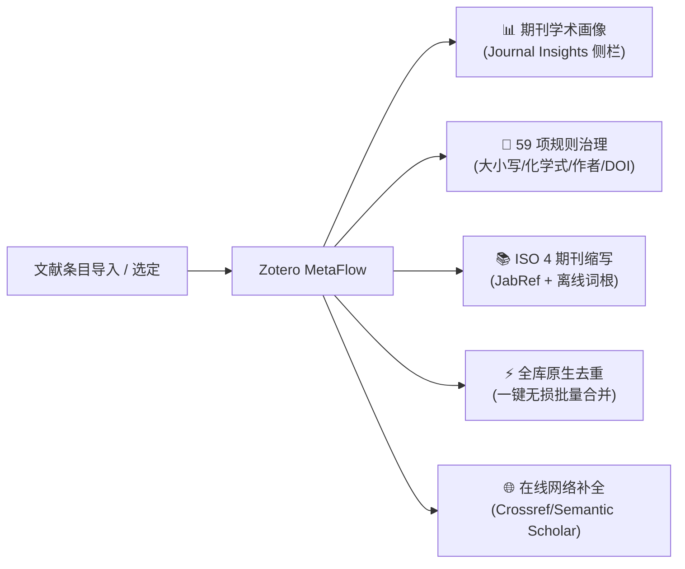

# Zotero MetaFlow

**文献元数据深度治理 · 权威学术期刊画像 · 全库原生智能去重**

_让研究的每一步衔接起来。 / Connect each step of research._

[简体中文](README.md) · [English](README.en.md)

[📦 下载安装](#installation) · [✨ 核心亮点](#highlights) · [🛠️ 功能矩阵](#features) · [🚀 快速开始](#quick-start) · [⚙️ 设置详解](#settings) · [🛡️ 架构与安全](#architecture) · [❓ 常见问题](#troubleshooting) · [🔗 系列插件](#series) · [📄 致谢与许可](#license)

---

## 📖 产品定位与愿景

日常科研中，从各大文献数据库（如 Web of Science、IEEE Xplore、PubMed、arXiv、知网）、浏览器网页或通过 DOI 批量导入的条目元数据往往良莠不齐：标题全大写或全小写、化学式上下标丢失、作者名颠倒错乱、缺少标准期刊缩写、缺少影响因子和分区评级，甚至充斥大量冗余重复项。

**Zotero MetaFlow**（隶属于 Zotero Flow Series 生产力套件）专为追求高标准文献管理的研究者设计。它深度融合了**59 项自动化元数据清洗规则**、**权威 ISO 4 离线期刊缩写引擎**、**EasyScholar 61 项学术指标**以及**独家深度集成的全库一键无损去重**，并提供全新的**无残余空白、自适应折叠的侧边栏期刊索引（Journal Insights）面板**，帮助您轻松构建专业、规整、充满学术洞察力的私有文献知识库。

> [!NOTE]
> 本插件为独立开源项目，不依赖特定环境，可单兵作战，亦可按需与 Zotero Flow 系列其他插件（如 RefFlow、MindFlow、ViewFlow 等）协同使用。

---

## ✨ 核心亮点

### 1. 📊 全景学术期刊画像（Journal Insights 侧栏深度集成）

- **学术评级一览无余**：在 Zotero 右侧条目详情栏中内嵌专属的“期刊索引”面板，实时呈现期刊封面微标、规范全称、标准 ISO 4 缩写。
- **多维权威指标覆盖**：
  - **Clarivate JCR 分区**：Q1 / Q2 / Q3 / Q4；
  - **中科院文献情报中心期刊分区**：最新升级版与基础版大类/小类分区、Top 期刊认证标识；
  - **学术影响指标**：最新影响因子（Impact Factor, IF）、五年影响因子；
  - **领域专精分级**：中国计算机学会（CCF）推荐目录评级（A / B / C 类）、顶会标注；
  - **前沿收录标识**：ESI 全球学科归属、Nature Index 2026 年度入选期刊本地标识。
- **现代化无损折叠架构（v13.0.0+ 突破）**：
  - 彻底解决原生折叠状态下的高度空缺与外边距留白问题，收起时**真正做到零高度（0px）、零间距**，展开时平滑自适应；
  - 支持数据空白时自愈隐藏（Empty-State Protection），并配备严格的组件级错误边界（Error Boundary），绝不阻塞宿主渲染。

### 2. ⚡ 一键全库原生无损去重（Native Bulk Deduplication）

- **深度融合原生生态**：直接无缝嵌入 Zotero 原生的“重复条目（Duplicate Items）”视图，在右侧工具区提供全局一键合并操作。
- **安全全局合并策略**：
  - **单次全局授权**：告别逐条重复确认的繁琐，单次确认即可自动对全库所有重复条目组完成合并；
  - **主条目智能判定**：默认以最早添加的条目为主条目，自动采纳最完整、最新的字段；
  - **空缺字段智能补全**：若主条目某些字段为空，自动从副条目中继承补齐，避免任何信息遗漏；
  - **资产完整保留**：全部附件（PDF、快照）、笔记、标签、集合归属、关联条目及原生的撤销历史（Undo）均由底层安全事务完整承接。
- **非侵入式进度反馈**：采用原生右下角轻量提示窗（Progress Notification），支持随时取消，安全透明。

### 3. 🧹 59 项多维元数据治理流水线

- **题名智能规范化**：
  - 支持句首字母大写（Sentence case）与首字母大写（Title Case）智能转换；
  - **独家化学式与专有名词保护引擎**：内置专业学术词典，自动识别并保护 $\text{CO}_2$、$\text{MoS}_2$、$\text{Fe}^{3+}$、$\text{mRNA}$、$\text{DNA}$、$\text{pH}$、$\text{in vivo}$ 等特殊大小写与上下标，避免格式化时被破坏。
- **摘要排版深度清洗**：
  - 智能去除多余的空行、段内断行与软回车，自动拼合截断的单词；
  - 识别并合并断行的化学式与科学计数法，保留原有段落逻辑。
- **作者与创作者规范**：
  - 智能校正作者姓氏与名字前后颠倒问题；
  - 自动清理拼音声调与乱码字符，规范机构作者与译者身份。
- **标识符与文献信息修正**：
  - **DOI 标准化**：自动剔除冗余的 URL 前缀（如 `https://doi.org/` 或 `doi:`），仅保留标准 Clean DOI；支持 ShortDOI 识别与完整 DOI 互转；
  - **页码优化**：将页码连接符统一规范为出版级 En-dash（`–`），并自动清除多余前导零（例如将 `001--008` 净化为 `1–8`）；
  - **日期规整**：将杂乱的出版日期清洗为标准 ISO 8601（`YYYY-MM-DD`）格式；
  - **高校与学位论文出版地补全**：内置全球数百所重点高校与所在城市关联数据库，自动推导并补齐硕博论文的出版城市。

### 4. 📚 权威期刊缩写与离线 ISO 4 引擎

- **双引擎强力驱动**：集成 JabRef 权威期刊全称/缩写映射库与国际标准 LTWA（List of Title Word Abbreviations）词根推断算法。
- **离线无网可用**：即使在完全断网的环境下，仍能依据国际 ISO 4 规则精确推断出规范的期刊标准缩写。
- **语言自适应处理**：智能识别中文与西文期刊，中刊支持规范拼音缩写或特定学报规范。

### 5. ✍️ 题名富文本排版工具栏（Rich-Text Title Helper）

- 在 Zotero 标题编辑输入框区域无缝集成轻量快捷工具条。
- 支持一键选区包裹 `<i>`（斜体 / 生物学名）、`<b>`（粗体）、``（下标 / 化学式）、``（上标 / 引用）以及 ``（大小写保护标签）。
- 完整保留原生选区、光标聚焦与键盘撤销历史。

---

## 🛠️ 核心功能矩阵

| 功能模块                          | 具体能力                                                                         | 解决的核心痛点                                              | 触发位置                          |
| --------------------------------- | -------------------------------------------------------------------------------- | ----------------------------------------------------------- | --------------------------------- |
| **期刊画像 (Journal Insights)**   | JCR 分区、中科院升级版大/小类分区、IF 影响因子、CCF 等级、Nature Index、ESI 标识 | 查阅文献时无需跳转外部网站，一秒获悉期刊学术声誉与分级      | 详情侧边栏 · 期刊索引面板         |
| **全库去重 (Bulk Deduplication)** | 原生重复组批量合并、主条目保护、缺省字段补齐、附件笔记无损继承                   | 解决大型文献库中成百上千重复项手动逐条合并的枯燥低效        | 集合树“重复条目” · 右上角操作区   |
| **标题格式化**                    | Sentence case / Title Case 转换，化学式、基因符号及专有名词大小写保护            | 统一各大数据库导入标题格式，保护科学符号不被粗暴抹去        | 条目右键菜单 / 设置中开启自动整理 |
| **摘要排版**                      | 段内硬断行消除、多余空白过滤、断行化学式拼合                                     | 解决从 PDF 提取或老旧数据库导入摘要断行破碎、排版混乱问题   | 条目右键菜单 / 自动清洗流水线     |
| **作者字段修复**                  | 姓名顺序颠倒反转、拼音多余符号过滤、机构作者属性矫正                             | 避免引文输出时出现“名当成姓”或“San, Zhang”的尴尬错乱        | 条目右键菜单 · 检查并修复元数据   |
| **期刊缩写统一**                  | JabRef 数据库匹配 + ISO 4 离线词根推断，支持全称与缩写互转                       | 满足投稿时不同期刊要求提供“期刊全称”或“标准 ISO 缩写”的需求 | 条目右键菜单 · 期刊名称/缩写整理  |
| **标识符标准化**                  | Clean DOI 提取、ShortDOI 解析、ISSN 自动校验与补全                               | 修复带复杂前缀的残缺 DOI，确保跨软件引文链接百分百通畅      | 条目右键菜单 · 规范标识符         |
| **多源在线补全**                  | 基于 DOI、ISBN、arXiv ID 向 Crossref、Semantic Scholar 请求权威元数据            | 挽救仅有标题或残缺字段的“半成品”文献条目                    | 条目右键菜单 · 更新在线元数据     |
| **题名富文本编辑**                | 快速插入斜体 `<i>`、粗体 `<b>`、上下标 `/`、保护标签                   | 原生题名输入框编辑特殊学术字符繁琐、易输错标签              | 题名编辑输入框浮动工具栏          |

---

## 🚀 快速开始与四大典型应用场景

### 场景一：即时查看期刊学术评级与指标（无需任何多余操作）

1. 在 Zotero 中选中任意已录入刊名的期刊论文条目。
2. 观察右侧条目详情面板——**“Zotero MetaFlow 期刊索引”**将自动展示：
   - 期刊封面与全称、标准 ISO 4 缩写；
   - JCR 分区与中科院大小类分区徽标；
   - 最新影响因子（IF）及 CCF 评级。
3. 点击面板右侧的折叠箭头，面板将**无缝贴合收起，不留任何空白间距**。

### 场景二：一键批量清洗与规范化文献条目

1. 在文献列表中按住 `Ctrl` 或 `Shift` 选中需要整理的一篇或多篇文献（支持跨集合全选）。
2. 在选中条目上单击鼠标右键，进入 **Zotero MetaFlow** 菜单：
   - 点击 **“检查并修复元数据”**：瞬间完成标题大小写转换、化学式保护、摘要排版清理、作者姓名正反校正与 DOI 规范化；
   - 点击 **“规范期刊名称与缩写”**：自动依据权威库与 ISO 4 统一期刊全称与缩写字段。
3. 界面右下角会弹出轻量通知，清晰汇报成功项数与字段变更摘要。

### 场景三：全库重复条目一键批量智能合并

1. 点击 Zotero 左侧文献库导航树中的 **“重复条目 (Duplicate Items)”**。
2. 列表将列出所有潜在重复组，右上角将出现 MetaFlow 专属的 **“一键合并当前库全部重复项”** 按钮。
3. 点击后弹出确认对话框，展示待处理组数；点击确认开始合并。
4. 底层将以高可靠事务安全处理各组，自动以最早条目为主条目补齐缺省信息，附件与笔记全部归拢，右下角提示合并完成。

### 场景四：快速输入题名中的化学式与斜体生物学名

1. 点击某篇文献的“题名 (Title)”字段进入编辑状态。
2. 选中文本中的特殊字符（例如 `Escherichia coli` 或 `CO2`）。
3. 使用上方弹出的富文本工具条，点击 `<i>` 即自动包裹为 `<i>Escherichia coli</i>`，选中数字 `2` 点击 `` 即变为 `CO2`。

---

## ⚙️ 偏好设置全景指南

在 Zotero 主菜单打开 **工具 → 插件／附加组件**（或在 Mac 上打开 **Zotero → 设置**），进入 **Zotero MetaFlow** 专属配置面板：

### 1. 通用设置 (General)

- **新条目自动整理**：开启后，每当通过浏览器插件、DOI 或 PDF 抓取新文献时，后台自动执行选定的清洗规则。
- **反馈通知模式**：可选择“右下角原生轻量通知”或“弹出详细变更报告”，兼顾静默高效与细致审计。

### 2. 元数据清洗规则 (Metadata Rules)

- 自由组合 **59 项规则细分开关**，精确控制：
  - 是否对全大写/全小写标题执行 Sentence case 转换；
  - 是否开启化学式、基因命名及物理单位的专有大写保护；
  - 摘要排版清洗力度（消除换行、合并破碎短句）；
  - 作者姓名颠倒智能侦测灵敏度；
  - 出版地自动推算数据库联动。

### 3. 期刊缩写与本地库 (Journal Abbreviations)

- 选择首选缩写风格（JabRef 规范 / ISO 4 点号缩写 / ISO 4 无点缩写）；
- 配置是否自动将中刊转换为标准拼音缩写；
- 查看随包内置的 **Nature Index 2026** 与 **ESI 学科期刊** 数据库版本状态。

### 4. 学术指标与 EasyScholar (Journal Indicators)

- **API 凭据管理**：输入您的 EasyScholar API Key（支持多项指标免费获取）；
- **主控与展示开关**：可分别独立控制“是否允许网络查询指标”、“是否在侧栏面板展示卡片”、“是否将指标写回条目的 Extra 字段”以及“是否在文献树注册自定义数据列”；
- **并发与缓存**：内置 72 小时本地安全持久缓存，避免重复请求浪费配额。

### 5. 重复条目合并策略 (Duplicate Merging)

- **主条目优选规则**：支持“最早添加优先（推荐）”、“最新修改优先”或“元数据最全优先”；
- **空缺字段继承**：严格保障副条目中主条目缺失的字段（如缺失的摘要或 DOI）被安全补全，冲突字段始终以主条目为准。

---

## 🛡️ 架构与数据安全机制

Zotero MetaFlow 遵循严格的企业级数据保护与容灾原则：

1. **细粒度条目变更日记（Item Mutation Journal）**：
   - 批处理过程中，若单条文献因外部异常发生中断，系统会自动回滚当前条目的脏状态，绝对不会污染前后其他健康的文献。
2. **读写分离与双层 LRU 缓存**：
   - 采用多级内存缓存与本地持久化机制，期刊画像指标与网络推断秒级响应，即使面对拥有数万条条目的大型文献库亦丝滑流畅。
3. **安全事务边界与非破坏性覆盖**：
   - 在线元数据补全默认采用“仅补全空缺字段（Blank-only）”策略，绝不擅自覆盖研究者精心校对过的既有数据；
   - 批量合并完全基于 Zotero 原生底层 Merge 事务驱动，全量保留关联、附件、笔记与历史 Undo 能力。
4. **沙箱隔离与错误边界（Error Boundary）**：
   - 侧边栏与设置页采用严格的 CSS 作用域与组件级 Try-Catch 错误拦截，发生不可预期的数据异常时优雅降级，绝不影响 Zotero 正常文献阅读与主界面操作。

---

## 📦 安装与自动更新

### 手动安装步骤

1. 前往 [GitHub Releases](https://github.com/groele/Zotero-MetaFlow/releases) 下载最新发行版安装包 **[zotero-metaflow.xpi](https://github.com/groele/Zotero-MetaFlow/releases/download/v13.0.1/zotero-metaflow.xpi)**（切勿下载 Source code ZIP 源码包）。
2. 在 Zotero 客户端顶部菜单中打开 **工具 → 插件／附加组件**（Tools → Plugins）。
3. 点击附加组件管理器右上角的 **设置齿轮图标 ⚙️**，选择 **从文件安装插件...（Install Add-on From File...）**。
4. 选择刚刚下载的 `.xpi` 文件，按照提示完成安装并重启 Zotero。

### 在线自动更新

插件内置官方更新源检查配置（更新清单：[dist/update.json](https://github.com/groele/Zotero-MetaFlow/blob/main/dist/update.json)，插件 ID：`metaflow@groele`）。当后续发布新版本时，Zotero 将在后台自动检索并提示您无缝升级。

---

## 🌐 兼容性与运行环境

| 运行环境        | 兼容支持范围                                           | 说明                                                   |
| --------------- | ------------------------------------------------------ | ------------------------------------------------------ |
| **Zotero 版本** | **Zotero 10.0 ～ 12.***（兼容现代 Gecko 153 平台架构） | 针对现代 Zotero 内核全面重构，支持原生侧边栏与深色模式 |
| **操作系统**    | Windows 10 / 11、macOS（Intel / Apple Silicon）、Linux | 全平台一致的高性能原生体验                             |
| **插件版本**    | **v13.0.1**                                            | [查看历史版本说明](docs/releases/metaflow-v13.0.1.md)  |

---

## ❓ 常见问题排查 (FAQ)

<b>Q1: 侧边栏的“期刊索引”没有显示指标或提示无法连接？</b>

1. **检查刊名**：确保文献条目的“刊名（Publication）”或“DOI”不为空且拼写正确。
2. **检查 API 密钥**：若需获取在线指标（如 CCF、中科院分区），请前往“设置 → Zotero MetaFlow → 学术指标”，确认已填入有效的 EasyScholar API Key 并勾选开启在线查询。
3. **本地快照覆盖**：对于 Nature Index 或 ESI 期刊，即使在断网状态下，只要刊名在内置权威快照中，仍会正常识别。

<b>Q2: 为什么格式化标题时某些专业词汇（如基因符号、化学式）没有变成小写？</b>

这正是 MetaFlow 的核心特性之一！MetaFlow 内置了强大的**学术专有名词与化学式保护词典**，专门防止将 $\text{mRNA}$、$\text{pH}$、$\text{CO}_2$、$\text{MoS}_2$ 等特有大小写误转为常规格式。如需调整特定规则，可在偏好设置的“元数据清洗规则”中自定义启用的开关。

<b>Q3: 一键批量合并重复项会把我的笔记或 PDF 附件弄丢吗？</b>

**绝对不会**。MetaFlow 的批量去重深度依托 Zotero 原生的合并事务机制。所有副条目中的 PDF 附件、网页快照、手写笔记、标签以及加入的分类集合，都会百分之百完整转移并归拢到保留的主条目下，并且保留 Zotero 原生的“撤销合并”历史记录。

<b>Q4: 批量处理时遇到卡顿或提示部分失败怎么办？</b>

MetaFlow 支持并发节流控制。对于成千上万篇的大规模文献库，建议在偏好设置中将并发度调至 2–4；同时 MetaFlow 配备了单条目事务回滚机制，即使极个别网络请求超时，其他健康条目均已成功保存，您只需在网络通畅时单独重试失败项即可。

---

## 🔗 Zotero Flow 系列生态

Zotero MetaFlow 属于 **Zotero Flow Series** 学术全流程加速套件的一员，各插件各司其职又互为补充：

| 插件名称                                                           | 核心职责与定位                                 | 协同场景                                                             |
| ------------------------------------------------------------------ | ---------------------------------------------- | -------------------------------------------------------------------- |
| [**Zotero MetaFlow**](https://github.com/groele/Zotero-MetaFlow)   | **元数据清洗 · 权威期刊指标 · 全库智能去重**   | 导入文献的第一站，让整个文献库干净、准确、富含学术分级               |
| [**Zotero RefFlow**](https://github.com/groele/Zotero-RefFlow)     | **文献引文网络发现 · 参考文献解析 · 一键导入** | 顺藤摸瓜检索参考文献、被引文献与相关研究，直接流转至 MetaFlow 规范化 |
| [**Zotero ViewFlow**](https://github.com/groele/Zotero-ViewFlow)   | **文献阅读侧栏预览 · 快速复制格式化引文**      | 边看 PDF 边在侧栏预览规范引文，一键复制纯文本或富文本                |
| [**Zotero MindFlow**](https://github.com/groele/Zotero-MindFlow)   | **知识图谱组织 · 思路大纲 · 文献导图**         | 将清洗后的优质文献与核心批注可视化组织为结构清晰的思维导图           |
| [**Zotero TaskFlow**](https://github.com/groele/Zotero-TaskFlow)   | **文献研读任务推进 · 进度看板 · 阅读计划**     | 追踪每一篇重点文献的精读进度与学术待办事项                           |
| [**Zotero CiteFlow**](https://github.com/groele/Zotero-CiteFlow)   | **写作引文追溯 · Word 联动 · 文献快速匹配**    | 写作时实时追踪文档引用，无缝联动 Zotero 库内规范条目                 |
| [**Zotero PaperFlow**](https://github.com/groele/Zotero-PaperFlow) | **投稿进度追踪 · 审稿意见归档 · 版本管理**     | 管理稿件投递、审稿轮次、审稿人意见回复（Response Letter）全生命周期  |

---

## 📄 二次开发声明与开源许可

- **开源衍生致谢**：Zotero MetaFlow 基于开源项目 [zotero-format-metadata](https://github.com/northword/zotero-format-metadata)（原作者 northword）二次开发，采用 `zotero-plugin-template` 与 `zotero-plugin-scaffold` 工具链构建，在此向原作者及开源社区致以崇高敬意。
- **开源协议**：本项目基于 **[AGPL-3.0-or-later](LICENSE)** 协议开源。
- **免责声明**：Zotero 及 Zotero 徽标属于 Corporation for Digital Scholarship 的商标。本系列由独立团队维护，并非 Zotero 官方机构产品。EasyScholar、Nature Index、Clarivate 等第三方数据服务的知识产权与最终解释权归各自所有者所有。
