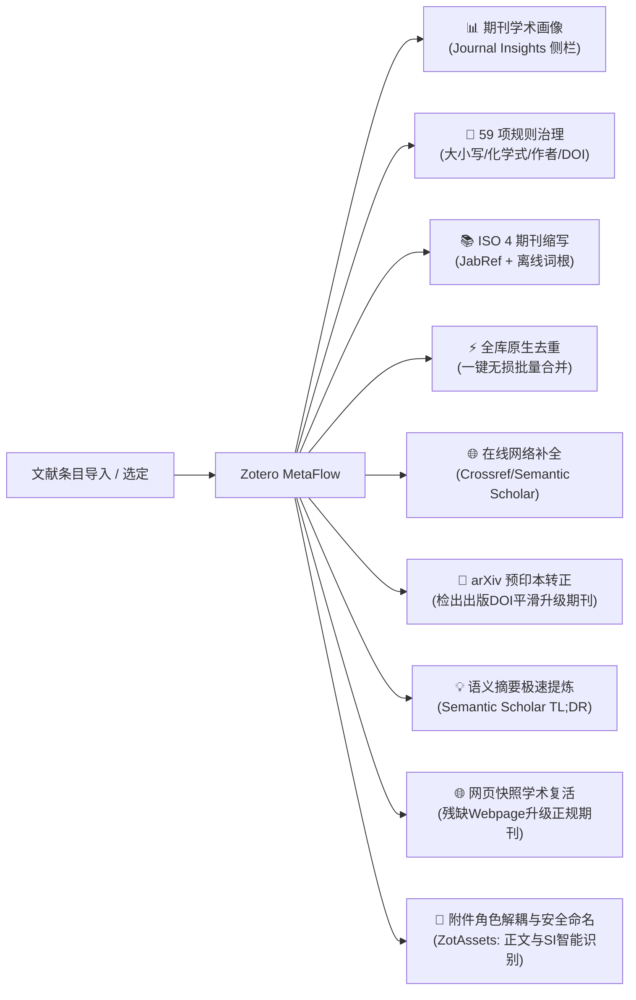

# Zotero MetaFlow

**文献元数据深度治理 · 权威学术期刊画像 · 全库原生智能去重 · arXiv 预印本转正 · Semantic Scholar TL;DR 论点提炼 · 网页快照学术复活**

_让研究的每一步衔接起来。 / Connect each step of research._

[简体中文](README.md) · [English](README.en.md)

[📦 下载安装](#installation) · [✨ 核心亮点](#highlights) · [🛠️ 功能矩阵](#features) · [🚀 快速开始](#quick-start) · [⚙️ 设置详解](#settings) · [🛡️ 架构与安全](#architecture) · [❓ 常见问题](#troubleshooting) · [🔗 系列插件](#series) · [📄 致谢与许可](#license)

---

## 📖 产品定位与愿景

日常科研中，从各大文献数据库（如 Web of Science、IEEE Xplore、PubMed、arXiv、知网）、浏览器网页或通过 DOI 批量导入的条目元数据往往良莠不齐：标题全大写或全小写、化学式上下标丢失、作者名颠倒错乱、缺少标准期刊缩写、缺少影响因子和分区评级，甚至充斥大量冗余重复项。

**Zotero MetaFlow**（隶属于 Zotero Flow Series 生产力套件）专为追求高标准文献管理的研究者设计。它深度融合了**59 项自动化元数据清洗规则**、**权威 ISO 4 离线期刊缩写引擎**、**EasyScholar 61 项学术指标**以及**独家深度集成的全库一键无损去重**，并提供全新的**无残余空白、自适应折叠的侧边栏期刊索引（Journal Insights）面板**，帮助您轻松构建专业、规整、充满学术洞察力的私有文献知识库。

> [!NOTE]
> 本插件为独立开源项目，不依赖特定环境，可单兵作战，亦可按需与 Zotero Flow 系列其他插件（如 RefFlow、MindFlow、ViewFlow 等）协同使用。

---

## ✨ 核心亮点

### 1. 📊 全景学术期刊画像（Journal Insights 侧栏深度集成）

- **学术评级一览无余**：在 Zotero 右侧条目详情栏中内嵌专属的“期刊索引”面板，实时呈现期刊封面微标、规范全称、标准 ISO 4 缩写。
- **多维权威指标覆盖**：
  - **Clarivate JCR 分区**：Q1 / Q2 / Q3 / Q4；
  - **中科院文献情报中心期刊分区**：最新升级版与基础版大类/小类分区、Top 期刊认证标识；
  - **学术影响指标**：最新影响因子（Impact Factor, IF）、五年影响因子；
  - **领域专精分级**：中国计算机学会（CCF）推荐目录评级（A / B / C 类）、顶会标注；
  - **前沿收录标识**：ESI 全球学科归属、Nature Index 2026 年度入选期刊本地标识。
- **现代化无损折叠架构（v13.0.0+ 突破）**：
  - 彻底解决原生折叠状态下的高度空缺与外边距留白问题，收起时**真正做到零高度（0px）、零间距**，展开时平滑自适应；
  - 支持数据空白时自愈隐藏（Empty-State Protection），并配备严格的组件级错误边界（Error Boundary），绝不阻塞宿主渲染。

### 2. 📄 arXiv 预印本智能转正（arXiv Preprint-to-Published Workflow）

- **深度汲取 AllanChain/zotero-arxiv-workflow 精髓**：针对学术界先投 arXiv 后发表期刊/会议的普遍规律，打造无缝转正与版本演进闭环。
- **深度整合进「更新元数据」与侧栏卡片**：
  - 自动智能识别库中的 arXiv 预印本文献（通过 `arxiv.org` URL、`archiveID` 或 `arXiv:` 标识符）；
  - **右键主流程深度整合**：全面纳入右键核心动作「**更新元数据**」，仅当智能检测到文献为**未转正的预印本**时才动态激活转正流程；面对普通期刊/会议论文时绝不误触发，无需多余独立菜单项，界面极致清爽；
  - **偏好设置自由可控**：在设置面板的「流水线设置」中配备专属开关，可由用户自主决定是否在更新元数据时自动检出预印本转正；
  - **侧边栏专属交互**：在右侧详情侧边栏直接呈现专属 **arXiv Preprint 卡片**，显示官方 arXiv 编号超链接，并配备醒目的「**⚡ 检查并转为正式发表版本…**」快捷触发按钮。
- **双模安全转正策略（自由可配）**：
  - **原地平滑升级（In-Place Upgrade）**：自动从 arXiv Atom API 与 CrossRef 检出正式发表 DOI 及出版卷期信息，将条目类型转为 `journalArticle` 或 `conferencePaper`，**原预印本的全部 PDF 附件、高亮批注、手写笔记、双向关联及标签毫发无损地完整继承**，并在 `Extra` 中自动沉淀完整的原始 arXiv 编号追溯凭据；
  - **关联新版本（Create Related Publication）**：保留原预印本不变，新建正式发表条目，并自动建立 Zotero 原生的双向「关联文献」链路。
- **智能勋章追溯**：已转正文献在侧边栏期刊索引中醒目点亮「**arXiv 已转正**」绿色勋章，学术演进历程一目了然。

### 3. ⚡ 一键全库原生无损去重（Native Bulk Deduplication）

- **深度融合原生生态**：直接无缝嵌入 Zotero 原生的“重复条目（Duplicate Items）”视图，在右侧工具区提供全局一键合并操作。
- **安全全局合并策略**：
  - **单次全局授权**：告别逐条重复确认的繁琐，单次确认即可自动对全库所有重复条目组完成合并；
  - **主条目智能判定**：默认以最早添加的条目为主条目，自动采纳最完整、最新的字段；
  - **空缺字段智能补全**：若主条目某些字段为空，自动从副条目中继承补齐，避免任何信息遗漏；
  - **资产完整保留**：全部附件（PDF、快照）、笔记、标签、集合归属、关联条目及原生的撤销历史（Undo）均由底层安全事务完整承接。
- **非侵入式进度反馈**：采用原生右下角轻量提示窗（Progress Notification），支持随时取消，安全透明。

### 4. 💡 语义摘要极速提炼：Semantic Scholar TL;DR 核心论点回填

- **汲取 syt2/Zotero-TLDR 精髓并深度原生进化**：针对海量文献阅读时“读完长篇摘要仍抓不住核心创新贡献”的痛点，直接整合 Semantic Scholar 官方 AI 大模型生成的 1~2 句极速摘要（Too Long; Didn't Read）。
- **无缝嵌入「更新元数据」核心流水线**：
  - 在执行「更新元数据」时，只要文献具备 DOI、arXiv 编号或 PMID，即可自动查询并获取该文献的核心创新论点；
  - **多目标自由回填（偏好设置自主可配）**：
    - **独立子笔记（推荐）**：自动创建/幂等更新格式优雅的子笔记（`💡 TL;DR 核心论点 (Semantic Scholar)`），绝不污染原始出版元数据；
    - **Extra 附加字段**：写入 `TLDR: ...` 字段，便于在 Zotero 表格列表中通过自定义列直接总览；
    - **双模并行（子笔记 + Extra）**：同时满足列表即时查阅与笔记深度沉淀；
    - **摘要缺失自愈补充**：当条目原有 `abstractNote` 为空时，自动将极速摘要补入摘要字段。
- **专属条目列表自定义列「撷论」**：在 Zotero 条目列表列右键菜单中直接原生注册「**撷论**」（TL;DR Takeaway）列，开启后文献的核心创新贡献在文库表格中横向直观总览，回填后即时刷新呈现！
- **侧边栏沉浸式展示**：在右侧详情侧边栏「期刊画像」面板中直接呈现专属的「**💡 核心论点 (TL;DR)**」高亮卡片，无需展开子笔记即可一目了然获取学术要义。

### 5. 🌐 网页快照与残废条目“一键复活”（Web Snapshot & Blog Reviver）

- **汲取 Snapshot Reviver 与 metadata-hunter 精髓**：针对在浏览器看到优质论文、Nature News 或学术博客时随手剪藏抓取为极度简陋的“网页（Webpage）”条目（无作者、无年份、无卷期、无 DOI，仅有残破 URL 与乱码标题）的核心痛点，打造智能化学术复活流水线。
- **三级级联学术指纹嗅探 (`discoverSnapshotIdentifiers`)**：
  - **URL 深度解析**：识别直接 DOI、Nature/Nature News 路径（如 `10.1038/d41586-...`）、arXiv ID（如 `2403.12345`）及 PubMed PMID / PMCID 等标识；
  - **关联 HTML 快照 `<head>` 精准探针**：自动解析条目关联快照文件或 HTML 头部中的 `<meta name="citation_doi">`、`<meta name="dc.identifier.doi">`、`<meta name="citation_arxiv_id">`、`<meta name="citation_pmid">`、`<link rel="canonical">` 等规范学术元标签，严格忽略正文参考文献 DOI 噪音；
  - **在线网页头部探针**：按需快速嗅探页面头部的规范学术元数据标识符。
- **学术级元数据反查与结构升级**：
  - 调用 Crossref / Semantic Scholar 反查完整元数据，一键将残破的 `webpage` 或 `blogPost` 升级为正规的 `journalArticle`（期刊论文）或 `preprint`（预印本）；
  - 全面补齐作者列表、出版年份/日期、期刊全称/缩写、卷号、期号、页码与 DOI 等全套学术字段。
- **无损溯源保护 (Provenance Extra)**：
  - 升级时完整保留网页原有快照标题与原始 URL，并在 `Extra` 中自动沉淀审计凭据（如 `MetaFlow revived from: webpage` 与 `MetaFlow snapshot title: ...`），资产零丢失。
- **无缝嵌入「更新元数据」与用户可控开关**：
  - 深度集成到右键核心菜单「**更新元数据**」中，与预印本转正、TL;DR 回填一气呵成；
  - 设置面板中提供「**复活网页快照与博客条目**」开关，由用户决定是否启用。

### 6. 📑 正文与补充材料 (SI) 角色解耦与安全命名（深度集成 ZotAssets 引擎）

- **攻克顶级期刊多附件管理的科研痛点**：
  - 许多世界顶级期刊（如 _Nature_、_Science_、_Cell_、_JACS_、_Angewandte_ 等）发表的论文，核心实验步骤、反应条件、表征谱图（NMR/XRD/TEM）与原始数据全部放置在几十上百页的 **补充材料（Supplementary Information, SI）** 附件中；
  - 传统 Zotero 导入或抓取多 PDF 附件时，文件名多为随机哈希或数字代码（如 `41586_2023_Article_BF_moesm1_ESM.pdf`），在条目树里全被泛化为“Full Text PDF”，极难辨识，查阅实验细节宛如大海捞针。
- **智能角色分类与启发式双引擎**：
  - **出版商文件名特征深度覆盖**：内置 Nature、Science、Wiley、ACS、RSC、Springer、Elsevier 等主流出版社的 SI 命名模式匹配（`suppinfo`、`moesm`、`esi`、`sm`、`appendix`、`补充材料`、`支持信息` 等）；
  - **PDF 前两页结构探针**：利用现代化 Gecko / PDFWorker 引擎实时分析 PDF 前两页文本，高灵敏度捕获 `Figure S1`、`Table S2`、`Scheme S1`、`Supplementary Information` 等结构性特征；
  - **母条目元数据交叉比对**：比对 DOI、标题、出版物名称等元数据，高置信度锁定真正的“正文主手稿（Manuscript）”。
- **跨平台安全命名与自定义模板**：
  - **自定义重命名模板**：偏好设置提供专属重命名模板输入，支持 `{author}`（第一作者）、`{year}`（出版年份）、`{title}`（文献标题）、`{role}`（角色标记：Main / Supplement）自由组合；
  - **全方位文件系统清洗**：严格剔除 Windows/macOS/Linux 非法字符（`: / \ < > * ?` 等）与控制字符，自动规避 Windows 历史遗留保留设备名（如 `CON`、`PRN`、`AUX` 等）；
  - **UTF-8 字符边界截断**：严格受控于操作系统单路径与文件名预算上限（`MAX_FILENAME_BYTES`），中英文混排绝不拆分多字节产生乱码，彻底杜绝超长路径导致的同步失败或文件丢失。
- **条目树视觉直观同步**：
  - 自动同步在 Zotero 附件条目树中将标题前缀标注为 `[正文] 论文标题` 与 `[补充材料 1] 论文标题`，文献结构清晰可辨。
- **100% 纯本地离线执行**：
  - 严格恪守双核解耦长期原则，整个解耦与重命名过程纯本地算法执行，零网络请求、零外部通信，飞行模式或内网隔离环境下瞬时完成。
- **多层级用户完全自主掌控**：
  - 顶层卡片「检查并修复元数据：执行步骤」中作为一级独立模块，支持独立勾选与半选联动；
  - 详细规则中提供独立主开关、PDF 重命名开关、条目标题同步开关与重命名模板输入框；
  - 条目右键菜单中提供独立按需命令「解耦正文与补充材料（SI）角色」。

### 7. 🧹 59 项多维元数据治理流水线

- **题名智能规范化**：
  - 支持句首字母大写（Sentence case）与首字母大写（Title Case）智能转换；
  - **独家化学式与专有名词保护引擎**：内置专业学术词典，自动识别并保护 $\text{CO}_2$、$\text{MoS}_2$、$\text{Fe}^{3+}$、$\text{mRNA}$、$\text{DNA}$、$\text{pH}$、$\text{in vivo}$ 等特殊大小写与上下标，避免格式化时被破坏。
- **摘要排版深度清洗**：
  - 智能去除多余的空行、段内断行与软回车，自动拼合截断的单词；
  - 识别并合并断行的化学式与科学计数法，保留原有段落逻辑。
- **作者与创作者规范**：
  - 智能校正作者姓氏与名字前后颠倒问题；
  - 自动清理拼音声调与乱码字符，规范机构作者与译者身份。
- **标识符与文献信息修正**：
  - **DOI 标准化**：自动剔除冗余的 URL 前缀（如 `https://doi.org/` 或 `doi:`），仅保留标准 Clean DOI；支持 ShortDOI 识别与完整 DOI 互转；
  - **页码优化**：将页码连接符统一规范为出版级 En-dash（`–`），并自动清除多余前导零（例如将 `001--008` 净化为 `1–8`）；
  - **日期规整**：将杂乱的出版日期清洗为标准 ISO 8601（`YYYY-MM-DD`）格式；
  - **高校与学位论文出版地补全**：内置全球数百所重点高校与所在城市关联数据库，自动推导并补齐硕博论文的出版城市。

### 8. 📚 权威期刊缩写与离线 ISO 4 引擎

- **双引擎强力驱动**：集成 JabRef 权威期刊全称/缩写映射库与国际标准 LTWA（List of Title Word Abbreviations）词根推断算法。
- **离线无网可用**：即使在完全断网的环境下，仍能依据国际 ISO 4 规则精确推断出规范的期刊标准缩写。
- **语言自适应处理**：智能识别中文与西文期刊，中刊支持规范拼音缩写或特定学报规范。

### 9. ✍️ 题名富文本排版工具栏（Rich-Text Title Helper）

- 在 Zotero 标题编辑输入框区域无缝集成轻量快捷工具条。
- 支持一键选区包裹 `<i>`（斜体 / 生物学名）、`<b>`（粗体）、``（下标 / 化学式）、``（上标 / 引用）以及 ``（大小写保护标签）。
- 完整保留原生选区、光标聚焦与键盘撤销历史。

---

## 🛠️ 核心功能矩阵

| 功能模块                                | 具体能力                                                                                        | 解决的核心痛点                                                                      | 触发位置                                                 |
| --------------------------------------- | ----------------------------------------------------------------------------------------------- | ----------------------------------------------------------------------------------- | -------------------------------------------------------- |
| **期刊画像 (Journal Insights)**         | JCR 分区、中科院升级版大/小类分区、IF 影响因子、CCF 等级、Nature Index、ESI 标识                | 查阅文献时无需跳转外部网站，一秒获悉期刊学术声誉与分级                              | 详情侧边栏 · 期刊索引面板                                |
| **arXiv 预印本转正**                    | 检出官方出版 DOI，一键无损升级为期刊论文或关联新版本，保留全部笔记与批注                        | 解决先存预印本后发表期刊，元数据陈旧需手动重新抓取且丢笔记的难题                    | 侧栏 arXiv 卡片 / 右键「更新元数据」动态触发             |
| **语义摘要提炼 (TL;DR)**                | 自动提取 Semantic Scholar 1~2 句 AI 核心论点，回填至子笔记/Extra 并在侧栏呈现                   | 解决海量文献摘要冗长、阅读低效、难以一眼获悉论文核心创新贡献的问题                  | 右键「更新元数据」/ 侧栏期刊画像卡片                     |
| **网页快照复活 (Snapshot Reviver)**     | 深度嗅探 URL / 快照 HTML 头部学术指纹，反查 Crossref/S2 一键升级正规期刊或预印本                | 彻底解决网页随手剪藏抓取为无作者、无卷期、无 DOI 的残缺死数据问题                   | 右键「更新元数据」（支持偏好设置开关）                   |
| **全库去重 (Bulk Deduplication)**       | 原生重复组批量合并、主条目保护、缺省字段补齐、附件笔记无损继承                                  | 解决大型文献库中成百上千重复项手动逐条合并的枯燥低效                                | 集合树“重复条目” · 右上角操作区                          |
| **标题格式化**                          | Sentence case / Title Case 转换，化学式、基因符号及专有名词大小写保护                           | 统一各大数据库导入标题格式，保护科学符号不被粗暴抹去                                | 条目右键菜单 / 设置中开启自动整理                        |
| **摘要排版**                            | 段内硬断行消除、多余空白过滤、断行化学式拼合                                                    | 解决从 PDF 提取或老旧数据库导入摘要断行破碎、排版混乱问题                           | 条目右键菜单 / 自动清洗流水线                            |
| **作者字段修复**                        | 姓名顺序颠倒反转、拼音多余符号过滤、机构作者属性矫正                                            | 避免引文输出时出现“名当成姓”或“San, Zhang”的尴尬错乱                                | 条目右键菜单 · 检查并修复元数据                          |
| **期刊缩写统一**                        | JabRef 数据库匹配 + ISO 4 离线词根推断，支持全称与缩写互转                                      | 满足投稿时不同期刊要求提供“期刊全称”或“标准 ISO 缩写”的需求                         | 条目右键菜单 · 期刊名称/缩写整理                         |
| **标识符标准化**                        | Clean DOI 提取、ShortDOI 解析、ISSN 自动校验与补全                                              | 修复带复杂前缀的残缺 DOI，确保跨软件引文链接百分百通畅                              | 条目右键菜单 · 规范标识符                                |
| **多源在线补全**                        | 基于 DOI、ISBN、arXiv ID 向 Crossref、Semantic Scholar 请求权威元数据                           | 挽救仅有标题或残缺字段的“半成品”文献条目                                            | 条目右键菜单 · 更新在线元数据                            |
| **题名富文本编辑**                      | 快速插入斜体 `<i>`、粗体 `<b>`、上下标 `/`、保护标签                                  | 原生题名输入框编辑特殊学术字符繁琐、易输错标签                                      | 题名编辑输入框浮动工具栏                                 |
| **正文与 SI 角色解耦 (ZotAssets 引擎)** | 自动识别主手稿与补充材料 (SI)、安全规避非法路径字符规范重命名、条目树同步标注 [正文]/[补充材料] | 解决顶刊 (Nature/Science) 实验细节全在几百页 SI 中、多个 PDF 命名混乱无法辨识的痛点 | 条目右键菜单 · 解耦正文与补充材料角色 / 检查并修复元数据 |

---

## 🚀 快速开始与七大典型应用场景

### 场景一：即时查看期刊学术评级与指标（无需任何多余操作）

1. 在 Zotero 中选中任意已录入刊名的期刊论文条目。
2. 观察右侧条目详情面板——**“Zotero MetaFlow 期刊索引”**将自动展示：
   - 期刊封面与全称、标准 ISO 4 缩写；
   - JCR 分区与中科院大小类分区徽标；
   - 最新影响因子（IF）及 CCF 评级。
3. 点击面板右侧的折叠箭头，面板将**无缝贴合收起，不留任何空白间距**。

### 场景二：一键批量清洗与规范化文献条目

1. 在文献列表中按住 `Ctrl` 或 `Shift` 选中需要整理的一篇或多篇文献（支持跨集合全选）。
2. 在选中条目上单击鼠标右键，进入 **Zotero MetaFlow** 菜单：
   - 点击 **“检查并修复元数据”**：瞬间完成标题大小写转换、化学式保护、摘要排版清理、作者姓名正反校正与 DOI 规范化；
   - 点击 **“规范期刊名称与缩写”**：自动依据权威库与 ISO 4 统一期刊全称与缩写字段。
3. 界面右下角会弹出轻量通知，清晰汇报成功项数与字段变更摘要。

### 场景三：全库重复条目一键批量智能合并

1. 点击 Zotero 左侧文献库导航树中的 **“重复条目 (Duplicate Items)”**。
2. 列表将列出所有潜在重复组，右上角将出现 MetaFlow 专属的 **“一键合并当前库全部重复项”** 按钮。
3. 点击后弹出确认对话框，展示待处理组数；点击确认开始合并。
4. 底层将以高可靠事务安全处理各组，自动以最早条目为主条目补齐缺省信息，附件与笔记全部归拢，右下角提示合并完成。

### 场景四：快速输入题名中的化学式与斜体生物学名

1. 点击某篇文献的“题名 (Title)”字段进入编辑状态。
2. 选中文本中的特殊字符（例如 `Escherichia coli` 或 `CO2`）。
3. 使用上方弹出的富文本工具条，点击 `<i>` 即自动包裹为 `<i>Escherichia coli</i>`，选中数字 `2` 点击 `` 即变为 `CO2`。

### 场景五：arXiv 预印本一键检出并转正为正式发表版本

1. 选中任意已录入的 arXiv 预印本（或含有 `arxiv.org` 链接的文献）。
2. 在右侧侧边栏即可看到醒目的 **arXiv Preprint** 卡片，展示官方编号与直达链接。
3. 点击卡片上的 **「⚡ 检查并转为正式发表版本…」**（或直接在选中的预印本上右键选择「**更新元数据**」）：
   - MetaFlow 自动向 arXiv Atom API 与 CrossRef 发起查询，检出出版商正式 DOI、正式刊名与发表卷期；
   - 确认转正后，条目平滑转为正式期刊论文，**原有 PDF 文件、全部划线高亮批注与笔记 100% 完整保留**，侧栏期刊画像实时更新并挂载「**arXiv 已转正**」绿色勋章。

### 场景六：一键提炼 Semantic Scholar TL;DR 核心论点

1. 选中任意包含 DOI、arXiv 编号或已入库的文献。
2. 右键选择「**更新元数据**」（或点击侧边栏更新按钮）。
3. MetaFlow 自动向 Semantic Scholar 请求 AI 极速提炼的核心贡献摘要，并自动回填至独立子笔记与 `Extra` 字段。
4. 再次点击该文献，右侧侧边栏立即呈现精美的「**💡 核心论点 (TL;DR)**」卡片，核心要义一秒速览。

### 场景七：正文与补充材料 (SI) 附件一键解耦与安全规范重命名

1. 选中一篇挂载了正文 PDF 与 Supplementary Information PDF 的顶级期刊文献（如 Nature/Science 论文）。
2. 在条目右键菜单选择 **Zotero MetaFlow ➔ 解耦正文与补充材料（SI）角色**（或在设置中开启该模块后直接运行“检查并修复元数据”）。
3. 观察左侧条目树与附件文件：
   - 附件标题自动同步为：`[正文] 论文标题` 与 `[补充材料 1] 论文标题`；
   - 物理 PDF 文件规范重命名为：`Author_Year_Title_Main.pdf` 与 `Author_Year_Title_Supplement.pdf`（支持自定义模板）；
   - 实验细节附件与正文论文一目了然，再无混淆困扰。

---

## ⚙️ 偏好设置全景指南

在 Zotero 主菜单打开 **编辑 ➔ 设置**（或在 macOS 上打开 **Zotero ➔ 设置**），进入 **Zotero MetaFlow** 专属配置面板。面板严格遵循 **Zotero 10 原生组件规范** 与 **双核解耦长期原则**，划分为 7 大顶级功能卡片：

### 1. 一般与自动化设置 (General & Automation)

- **新条目自动整理 (`lint.onAdded`)**：开启后，每当通过浏览器插件、DOI 或 PDF 抓取新文献时，后台自动执行已启用的本地格式规则；
- **群组库写入防护 (`lint.onGroup`)**：默认关闭，安全防护只读群组与外部共享库，避免意外触发网络同步冲突；
- **文献导入延迟时间 (`lint.delayOnAdded`)**：可调节 100~5000ms（默认 500ms），给予外部抓取器下载大体积 PDF 附件及元数据就绪充足缓冲；
- **并发队列与通知 (`lint.numConcurrent`, `lint.notify`)**：支持 1~16 并发任务，处理完成后在右下角弹出轻量进度汇总。

### 2. 核心工作流与右键菜单 (Core Workflows ── 双核解耦专区)

- **流水线 A：「检查并修复元数据：执行步骤」【100% 纯本地离线执行】**：
  - 绝不发起任何外部网络请求，飞行模式与隔离内网完全可用；
  - 包含 7 大一级模块复选框与半选双向联动：
    1. `标题及短标题全部检查与格式功能`
    2. `作者信息全部检查与格式功能`
    3. `DOI 本地检查与格式功能`
    4. `卷、期、页码全部格式功能`
    5. `期刊与会议名称、缩写全部格式功能`
    6. `正文与补充材料 (SI) 角色解耦与规范命名`（ZotAssets 引擎）
    7. `其他条目、语言、日期与类型规则`
  - 检查完成后可勾选交互核对重复候选（代替后台高频重复扫描）。
- **流水线 B：「更新元数据：执行步骤」【集中收敛在线学术增强】**：
  - 统一归口所有外部网络服务，每个在线步骤均具备独立启闭开关与熔断超时防护：
    - `在线书目核验与自动补全`：向 Crossref 查询官方权威出版元数据；
    - `自动检测预印本并转为正式发表版本`：arXiv 预印本版本在线平滑转正；
    - `网页快照学术复活`：嗅探残缺网页快照的学术指纹并反向升级为正式学术文献；
    - `自动提炼 Semantic Scholar TL;DR 核心论点`：支持写入 Extra、独立子笔记与条目面板 Web Components 原生「撷论」行；
    - `更新期刊分区与评级`：更新 EasyScholar 61 项评价指标；
    - `采纳后运行本地格式规则`：在线补全后自动联动本地格式整理。
- **补充检索卡片**：缺少标识符时低频可选扫描 PDF 缓存或按标题联网检索；
- **右键菜单显示位置定制**：33 项命令均可自由配置为“右键一级菜单”、“MetaFlow 子菜单”或“关闭隐藏”。

### 3. 详细格式化规则 (Detailed Rules ── 7 个折叠子卡片)

- **条目与附件规则**：
  - 正文与补充材料 (SI) 角色解耦主开关 (`rule.correct-attachment-roles`)；
  - PDF 文件规范重命名 (`renamePdf`) 与附件条目标题同步 (`syncTitle`)；
  - **PDF 安全重命名模板 (`template`)**：支持 `{author}_{year}_{title}_{role}` 自定义占位符；
  - 网页类型误用清理、预印本类型误用清理、无效空值字段清理与字段误用校正。
- **语言规则**：语言代码规范化（zh-CN, en-US），支持过滤仅允许特定语种。
- **标题规则**：Sentence case 句子首字母大写、化学式/分子式下标排版保护（如 $\text{MoS}_2$）、末尾句号清理、短标题生成。
- **作者规则**：作者姓名大小写、中国作者拼音校正（Zhang, San）、标点清洗、在线修复不完整作者名单。
- **标识符规则**：Clean DOI 提取、剥离 `https://doi.org/` 冗余前缀、ShortDOI 模式校验。
- **期刊与会议规则**：出版物别名映射、ISO 4 权威缩写推断（内置 56,000+ 离线词库）、19 种学科 Profile、点号保留与自定义字典路径。
- **卷期页码规则**：En-dash 连接符（`–`）、缩写页码区间展开（`123-28` ➔ `123-128`）、前导零清理、Extra 字母序重排与摘要排版整理。

### 4. 按需工具中心 (On-Demand Tool Center)

- 17 款免污染独立工具即选即跑（如批量互换作者姓名、添加《》书名号、清空/清理 Extra、获取 ShortDOI、查询 ESI/Nature Index 等）。

### 5. 重复条目识别与合并治理 (Duplicate Management)

- **默认动作**：取消（`cancel`）、保留（`keep`）、丢弃（`discard`）、每次询问（`ask`）；
- **主条目择优策略**：最早添加优先（`oldest`）、最新添加优先（`newest`）、最近修改优先（`modified`）、元数据最详尽优先（`detailed`）；
- **跨类型合并保护**：允许/禁止预印本与正式期刊条目合并；
- **非重复记忆白名单**：支持一键导出/导入人工确认的非重复文献对。

### 6. 期刊评价与 EasyScholar (Journal Rankings)

- EasyScholar API Key 凭据配置；
- 61 项权威学术指标勾选网格与列表显示列（Columns）配置；
- Extra 写入与期刊缩写同步开关。

### 7. 数据策略、学术洞察与快捷键 (Data Policy & Insights)

- ESI / Nature Index 本地数据源模式与自定义 JSON/CSV 路径；
- 期刊卡片分享格式（图片/文本/静默复制）；
- 200MB / 30 天缓存清理策略；
- 富文本工具栏与全套快捷键自定义。

---

## 🛡️ 架构与数据安全机制

Zotero MetaFlow 遵循严格的企业级数据保护与容灾原则：

1. **细粒度条目变更日记（Item Mutation Journal）**：
   - 批处理过程中，若单条文献因外部异常发生中断，系统会自动回滚当前条目的脏状态，绝对不会污染前后其他健康的文献。
2. **读写分离与双层 LRU 缓存**：
   - 采用多级内存缓存与本地持久化机制，期刊画像指标与网络推断秒级响应，即使面对拥有数万条条目的大型文献库亦丝滑流畅。
3. **安全事务边界与非破坏性覆盖**：
   - 在线元数据补全默认采用“仅补全空缺字段（Blank-only）”策略，绝不擅自覆盖研究者精心校对过的既有数据；
   - 批量合并完全基于 Zotero 原生底层 Merge 事务驱动，全量保留关联、附件、笔记与历史 Undo 能力。
4. **沙箱隔离与错误边界（Error Boundary）**：
   - 侧边栏与设置页采用严格的 CSS 作用域与组件级 Try-Catch 错误拦截，发生不可预期的数据异常时优雅降级，绝不影响 Zotero 正常文献阅读与主界面操作。

---

## 📦 安装与自动更新

### 手动安装步骤

1. 前往 [GitHub Releases](https://github.com/groele/Zotero-MetaFlow/releases) 下载最新发行版安装包 **[zotero-metaflow.xpi](https://github.com/groele/Zotero-MetaFlow/releases/download/v13.0.2/zotero-metaflow.xpi)**（切勿下载 Source code ZIP 源码包）。
2. 在 Zotero 客户端顶部菜单中打开 **工具 → 插件／附加组件**（Tools → Plugins）。
3. 点击附加组件管理器右上角的 **设置齿轮图标 ⚙️**，选择 **从文件安装插件...（Install Add-on From File...）**。
4. 选择刚刚下载的 `.xpi` 文件，按照提示完成安装并重启 Zotero。

### 在线自动更新

插件内置官方更新源检查配置（更新清单：[dist/update.json](https://github.com/groele/Zotero-MetaFlow/blob/main/dist/update.json)，插件 ID：`metaflow@groele`）。当后续发布新版本时，Zotero 将在后台自动检索并提示您无缝升级。

---

## 🌐 兼容性与运行环境

| 运行环境        | 兼容支持范围                                           | 说明                                                   |
| --------------- | ------------------------------------------------------ | ------------------------------------------------------ |
| **Zotero 版本** | **Zotero 10.0 ～ 12.***（兼容现代 Gecko 153 平台架构） | 针对现代 Zotero 内核全面重构，支持原生侧边栏与深色模式 |
| **操作系统**    | Windows 10 / 11、macOS（Intel / Apple Silicon）、Linux | 全平台一致的高性能原生体验                             |
| **插件版本**    | **v13.0.2**                                            | [查看历史版本说明](docs/releases/metaflow-v13.0.2.md)  |

---

## ❓ 常见问题排查 (FAQ)

<b>Q1: 侧边栏的“期刊索引”没有显示指标或提示无法连接？</b>

1. **检查刊名**：确保文献条目的“刊名（Publication）”或“DOI”不为空且拼写正确。
2. **检查 API 密钥**：若需获取在线指标（如 CCF、中科院分区），请前往“设置 → Zotero MetaFlow → 学术指标”，确认已填入有效的 EasyScholar API Key 并勾选开启在线查询。
3. **本地快照覆盖**：对于 Nature Index 或 ESI 期刊，即使在断网状态下，只要刊名在内置权威快照中，仍会正常识别。

<b>Q2: 为什么格式化标题时某些专业词汇（如基因符号、化学式）没有变成小写？</b>

这正是 MetaFlow 的核心特性之一！MetaFlow 内置了强大的**学术专有名词与化学式保护词典**，专门防止将 $\text{mRNA}$、$\text{pH}$、$\text{CO}_2$、$\text{MoS}_2$ 等特有大小写误转为常规格式。如需调整特定规则，可在偏好设置的“元数据清洗规则”中自定义启用的开关。

<b>Q3: 一键批量合并重复项会把我的笔记或 PDF 附件弄丢吗？</b>

**绝对不会**。MetaFlow 的批量去重深度依托 Zotero 原生的合并事务机制。所有副条目中的 PDF 附件、网页快照、手写笔记、标签以及加入的分类集合，都会百分之百完整转移并归拢到保留的主条目下，并且保留 Zotero 原生的“撤销合并”历史记录。

<b>Q4: 批量处理时遇到卡顿或提示部分失败怎么办？</b>

MetaFlow 支持并发节流控制。对于成千上万篇的大规模文献库，建议在偏好设置中将并发度调至 2–4；同时 MetaFlow 配备了单条目事务回滚机制，即使极个别网络请求超时，其他健康条目均已成功保存，您只需在网络通畅时单独重试失败项即可。

---

## 🔗 Zotero Flow 系列生态

Zotero MetaFlow 属于 **Zotero Flow Series** 学术全流程加速套件的一员，各插件各司其职又互为补充：

| 插件名称                                                           | 核心职责与定位                                 | 协同场景                                                             |
| ------------------------------------------------------------------ | ---------------------------------------------- | -------------------------------------------------------------------- |
| [**Zotero MetaFlow**](https://github.com/groele/Zotero-MetaFlow)   | **元数据清洗 · 权威期刊指标 · 全库智能去重**   | 导入文献的第一站，让整个文献库干净、准确、富含学术分级               |
| [**Zotero RefFlow**](https://github.com/groele/Zotero-RefFlow)     | **文献引文网络发现 · 参考文献解析 · 一键导入** | 顺藤摸瓜检索参考文献、被引文献与相关研究，直接流转至 MetaFlow 规范化 |
| [**Zotero ViewFlow**](https://github.com/groele/Zotero-ViewFlow)   | **文献阅读侧栏预览 · 快速复制格式化引文**      | 边看 PDF 边在侧栏预览规范引文，一键复制纯文本或富文本                |
| [**Zotero MindFlow**](https://github.com/groele/Zotero-MindFlow)   | **知识图谱组织 · 思路大纲 · 文献导图**         | 将清洗后的优质文献与核心批注可视化组织为结构清晰的思维导图           |
| [**Zotero TaskFlow**](https://github.com/groele/Zotero-TaskFlow)   | **文献研读任务推进 · 进度看板 · 阅读计划**     | 追踪每一篇重点文献的精读进度与学术待办事项                           |
| [**Zotero CiteFlow**](https://github.com/groele/Zotero-CiteFlow)   | **写作引文追溯 · Word 联动 · 文献快速匹配**    | 写作时实时追踪文档引用，无缝联动 Zotero 库内规范条目                 |
| [**Zotero PaperFlow**](https://github.com/groele/Zotero-PaperFlow) | **投稿进度追踪 · 审稿意见归档 · 版本管理**     | 管理稿件投递、审稿轮次、审稿人意见回复（Response Letter）全生命周期  |

---

## 📄 开源项目声明、衍生致谢与许可

Zotero MetaFlow 的诞生、设计与持续演进深度依托并受益于开源社区的卓越智慧与成果。在此特别向以下杰出的开源项目、数据资源与作者致以由衷的敬意与谢意：

### 1. 核心衍生与灵感来源上游项目

- **[northword/zotero-format-metadata](https://github.com/northword/zotero-format-metadata)**（Linter for Zotero by @northword）：
  本项目最初基于 northword 老师开创的 `zotero-format-metadata` 二次开发与架构演进。其极具前瞻性的元数据清洗规则系统（Rule System）、批处理流水线与扩展机制为本项目奠定了坚实的基础。
- **[zoushucai/zotero-journalabbr](https://github.com/zoushucai/zotero-journalabbr)**（by @zoushucai）：
  为期刊全称规范化、中英文期刊缩写映射词表及学术数据整理提供了至关重要的设计启发与实现借鉴。
- **[redleafnew/zotero-updateifsE](https://github.com/redleafnew/zotero-updateifsE)**（by @redleafnew）：
  为 EasyScholar 学术期刊评价指标对接、中科院分区与影响因子检索、条目 Extra 字段回写以及侧栏卡片展示体系的设计提供了极具价值的实践指引。
- **[ChenglongMa/zoplicate](https://github.com/ChenglongMa/zoplicate)**（by @ChenglongMa）：
  为重复条目智能检测、重复组算法与批量安全合并工作流设计提供了重要的工程参考。
- **[RoadToDream/ZotMeta](https://github.com/RoadToDream/ZotMeta)**（by @RoadToDream）：
  为基于多标识符（DOI、ISBN、PMID/PMCID、arXiv）的文献身份核验与多源元数据交叉验证机制提供了设计灵感。
- **[bwiernik/zotero-shortdoi](https://github.com/bwiernik/zotero-shortdoi)**（DOI Manager by @bwiernik）：
  为标准 Clean DOI 提取、ShortDOI 转换与双向解析规则的实现提供了关键参考。
- **[AllanChain/zotero-arxiv-workflow](https://github.com/AllanChain/zotero-arxiv-workflow)**（by @AllanChain）：
  为预印本到正式发表版本（arXiv preprint-to-published）的自动化检出、原子化元数据转换、附件笔记保留及双向版本关联网络提供了卓越的设计灵感与核心思路，促成本插件原生整合高质高效的 arXiv 预印本一键转正功能。
- **[syt2/Zotero-TLDR](https://github.com/syt2/Zotero-TLDR)**（by @syt2）：
  为基于 Semantic Scholar API 极速提取文献核心贡献（TL;DR，Too Long; Didn't Read）一两句话 AI 提炼摘要、并在 Zotero 中优雅回填至子笔记与附加信息提供了重要范例与实现参考。
- **[Lyz-623/ZotAssets](https://github.com/Lyz-623/ZotAssets)**（by @Lyz-623）：
  为正文主手稿（Manuscript）与补充材料（Supplementary Information, SI）角色的智能解耦、跨平台文件安全命名清洗（规避非法字符与保留设备名）、UTF-8 字节精确截断以及 Zotero 附件条目标题层级同步提供了极具价值的黑科技设计与工程参考，促成本项目将 ZotAssets 引擎深度原生整合进本地离线治理流水线中。

### 2. 插件工程脚手架与工具链

- **[windingwind/zotero-plugin-template](https://github.com/windingwind/zotero-plugin-template)**（by @windingwind）：现代化的 Zotero 插件开发模板与 TypeScript 工程规范。
- **[northword/zotero-plugin-scaffold](https://github.com/northword/zotero-plugin-scaffold)**（by @northword）：专业高效的 Zotero 插件构建、打包与开发脚手架。
- **[windingwind/zotero-plugin-toolkit](https://github.com/windingwind/zotero-plugin-toolkit)**（by @windingwind）：功能强大的 Zotero 运行时 API 抽象与界面交互工具库。

### 3. 权威学术数据资源与开放 API 服务

- **[JabRef / abbrv.jabref.org](https://github.com/JabRef/abbrv.jabref.org)**：提供了权威、全面、高质量的全球学术期刊全称与 ISO 4 缩写映射开源数据集。
- **[marcocorvi/abbreviso](https://github.com/marcocorvi/abbreviso)**：提供了基于国际 LTWA（List of Title Word Abbreviations）规则集的期刊缩写离线词根推断算法。
- **[EasyScholar](https://www.easyscholar.cc/)**：提供了高效便捷的学术期刊分级、中科院分区与学术影响力开放查询服务。
- **[Nature Index](https://www.nature.com/nature-index/)**：施普林格·自然旗下权威自然科学科研产出评价体系。
- **[Clarivate Web of Science / JCR](https://clarivate.com/)** & **中科院文献情报中心**：期刊分区与学术评价权威标准。
- **[CrossRef API](https://api.crossref.org/)** / **[Semantic Scholar API](https://api.semanticscholar.org/)**：开放学术元数据检索与补充支持。
- **[shortdoi.org](https://shortdoi.org/)** & **[doi.org](https://www.doi.org/)**：数字对象唯一标识符解析与短标识符生成服务。
- **[ISO 639-3 数据映射](https://github.com/wooorm/iso-639-3)** & **教育部全国高等学校名单**：语言识别与高校学位论文出版地推断数据库。

### 4. 社区规范与格式指南

- **[Zotero 字段填写规范](https://github.com/l0o0/translators_CN/issues/257)**（by @zepinglee）：中文社区广泛认可的字段录入与学术格式规范指南。
- **Zotero 法语翻译团队**：使用手册与本地化指导。

---

## ⚖️ 开源许可证与免责声明

- **开源协议**：本项目遵循 **[AGPL-3.0-or-later](LICENSE)** 开源协议。插件所有衍生的独立修改与新增功能均保持开放，第三方组件、数据集和开源项目保留其原有版权声明与许可条款。
- **免责声明**：Zotero 及 Zotero 徽标属于 Corporation for Digital Scholarship 的商标。本系列由独立团队维护，并非 Zotero 官方机构产品。EasyScholar、Nature Index、Clarivate 等第三方数据服务的知识产权与最终解释权归各自所有者所有。
