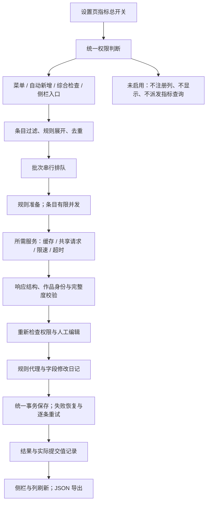

# MetaFlow 10.6.0：API、期刊指标权限、列与完整执行链审查

日期：2026-10-17。源码基线：项目内维护工作树 `.scaffold/publish/metaflow-10.0.1` 的 10.5.0；本次本地候选版本为 10.6.0。

工作区外层根目录仍保留较早的 10.0.0 源码及本轮初始审查修改。根据用户提供的侧栏和设置截图，实际功能对应 10.5.0 维护工作树。因此最终修复在维护工作树上完成，保留其评级、作者补全、离线缩写、持久缓存和安静反馈流程，没有用旧源码覆盖新实现。

## 1. 最终权限规则

用户最后明确：设置页的指标选择是最高优先级。

**指标总开关 → 是否允许查询和写入 → 侧栏显示／可选列入口 → 常用列的位置与可见性。**

- 61 种评级字段均具备建列实现，但只有设置页勾选的字段才注册对应列、进入侧栏和参与更新。
- 未勾选的指标，即使已有 Extra 值、旧列开关为真或还有旧的回调，也不显示和使用。
- 关闭指标保留已有 Extra 内容。重新启用后可以恢复显示，无须重新查询。
- 列的独立开关只决定已启用指标位于列菜单主层还是“更多列”，不能越过总开关；父指标关闭时相应控件不可用。
- ESI 总开关同时控制 ESI 列、侧栏、匹配依据、来源列和查询工具；新增 Nature Index 总开关控制同类入口。
- API 请求返回前重新检查总开关：等待期间关闭的字段不写回。关闭的本地 ESI／Nature 索引不加载；总开关变化会使组合索引缓存失效。
- 所有指标关闭时，侧栏隐藏、期刊操作不派发网络任务；标题等其他整理仍可正常运行。
- “测试连接”是设置页明确执行的连接诊断，不等于启用任何评级字段。

EasyScholar 的期刊查询接口按期刊返回整组数据，插件不能据此要求服务端只返回两个字段。本次控制的是是否发起相应来源请求，以及接收后哪些字段可以消费、写入和展示。补充来源则仅对选中的补充字段派发请求。

## 2. API 是否得到了有效利用

现有实现已经连接 61 种字段，包括官方字段、自定义评级库和补充来源；不能仅因设置页有选项就称全部真实账号权限均可用。

| 路径 | 已实现的利用方式 | 本次核查和修复 |
| --- | --- | --- |
| EasyScholar 期刊 API | 期刊名查询、官方／自定义数据解析、所选字段写 Extra、连接测试、返回状态反馈 | 纠正异常对象被字符串化、未知收录值被判“是”；保护等待期间改刊名、改评级和关闭字段。 |
| 补充期刊来源 | 与主要服务并行，按选中字段派发；独立截止时间和部分成功 | 保留原有分源隔离；主服务失败不吞掉成功补充值。 |
| ESI 与 Nature Index | 独立来源优先级、本地回退、明确匹配依据和来源 | 加总开关拦截与展示过滤；相关依据和来源也支持可选列。 |
| Zotero 元数据转换器 | 标识符、条目、网页查询，可信候选合并，作者修复 | 作品标识符中途变动时弃用旧结果；迁移检查当前字段，避免丢失新填数据。 |
| arXiv／Semantic Scholar／CNKI | 关联标识符、元数据或标题／作者补全 | 保留维护版已有策略和缓存，不复制旧工作链；外部结果仍须通过现有身份边界。 |
| 公共 DOI 查询 | 补 DOI、短 DOI 转换和验证、公共缓存 | 返回前校验源字段与目标字段，避免覆盖新 DOI 或把旧 short-doi 绑到新文献。 |

服务已有成功结果的内存与配置目录持久缓存、72 小时期限、同资源并发共享和实际请求限速。缓存读取或增加别名不自动续期；手动连接测试绕过成功缓存。列绘制和普通侧栏显示只读已保存值／已有索引缓存，不在每个单元格发请求。

本次通过受控 API 响应验证请求、解析、字段选择、异常、缓存与写入链；另在已登录 EasyScholar 的官方测试接口中实际查询 Nature，获得 code=200 与下面的自然指数命中。该单次实测不代表所有 61 个字段的账号权限、付费字段或服务年份均已逐项验收。凭据不写入测试夹具、报告或交付包。

### Nature Index 数据集的重新核实

2026-10-17 在账号的“自定义数据集 → 已选数据集 → 详情”现场核对：

| 项目 | 已核实内容 |
| --- | --- |
| 当前名称 | `177种自然指数统计期刊-2026` |
| 数据集编号／UUID | `1615199999904223232` |
| 简称 | 自然指数 |
| 创建方 | easyScholar |
| 创建时间／修改时间 | 2023-01-17／2026-06-15 |
| 页面数据量 | 178 条；这是平台标注的条目数，不能自行解释为 178 种有效期刊 |
| 文档入口 | [账号数据集](https://www.easyscholar.cc/console/rank/user)、[开放接口规范](https://www.easyscholar.cc/console/user/open)（需要登录） |

官网公开旧文档仍列“82 种自然指数统计期刊”，不适合据此断言当前账号没有 177 种目录。[Nature 官方 FAQ](https://www.nature.com/nature-index/faq) 第 6 节明确，2026 年 6 月范围为 177 种期刊和 1 个会议录，共 178 个来源；第 18 节列出 IROS 会议。本地现有数据也包含 177 个 journal 与 1 个 conference，期刊匹配会排除会议类型。EasyScholar 页面标注同为 178 条；本轮未导出其逐条记录，不能仅凭数量宣称两套名单完全相同。

实际 Nature 查询返回的非敏感片段：

```json
{
  "customRank": {
    "rankInfo": [{
      "uuid": "1615199999904223232",
      "abbName": "自然指数",
      "oneRankText": " "
    }],
    "rank": ["1615199999904223232&&&1"]
  }
}
```

原有实现依赖完整名称且要求等级文字非空，导致上述真实响应无法识别；它对带“-2026”的名称也匹配失败。本次按稳定 UUID 自动识别该目录，支持规范中的 `UUID&&&等级`（1–5）、保留历史编码兼容、识别年份后缀，允许收录目录的有效命中带空白等级文字。显式指定其他 UUID 时仍优先遵从指定值。侧栏保留 API 返回的实际名称／简称，不根据内置编号硬造接口未返回的年份。没有匹配 rank、数据集缺失或无效编码都保持未知，不推断为不收录。

同时修复一般自定义评级只处理第 1、2 级而遗漏第 3–5 级的问题，并禁止异常对象被写成字符串；CCF 推荐目录不再越过未选中的 CCF 总开关写入 CCF 字段。

使用方式：在 EasyScholar 账号添加此数据集；在 MetaFlow 设置启用 Nature Index，再把其来源优先级设为“API 优先”或“仅 API”，执行自然指数查询。UUID 留空已可自动识别，也可填写上面的编号。“仅本地”的选择继续只查本地，不能把本地结果误标成 API 结果。ESI 与 Nature 的查询共用同一次期刊 API 结果，普通选择条目和绘制列不发请求。

## 3. 完整工作链条



### 启动和卸载

Bootstrap 建立 Gecko 沙箱和默认偏好；Addon 保存共享实例。hooks 等待宿主初始化后注册偏好、菜单、通知、列、侧栏、快捷键及原生标题工具栏。卸载先标记失活、关闭交互、取消任务，再按资源隔离解除注册。构建仍兼容 Firefox 140，并在指定 Gecko 153 开发构建验证。

### 自动导入和手动入口

新增通知只合并 ID，不占用导入事务。延迟后重新检查开关、群组、编辑权限、回收站、订阅和空标题，后台补全使用补空策略。手动综合工作流复用相同规则，作者修复、元数据更新和期刊评级有独立选择。总开关在实际调用处再次检查，不能靠隐藏菜单代替执行约束。

### 批处理和保存

批次串行，条目并发 1–16，每条目内规则按顺序运行。prepare 支持取消；apply 有截止时间与撤销写权限的代理。失败规则只恢复自身修改，健康规则继续；事务失败重新载入并恢复拟保存快照，再逐条重试。维护版既有永久保存失败恢复保留。

本次修复了同一规则多次写一个字段时丢失中途人工编辑的问题，也让报告中的 saved 对应实际提交的最终字段值。中间值仍可追踪，但不会被误称已经持久化。

### 侧栏与列

侧栏和评级列共用 canonical／历史别名／全角冒号的 Extra 解析。每个条目按 Extra 文本缓存解析结果；文字改变后自动失效，弱引用不长期保留条目。

已启用的每项评级都有独立列；保留稳定的 ESI、Nature Index 标识，另提供两套匹配依据与数据来源列。期刊名称继续使用 Zotero 自带“出版物”列。

数值指标使用排序值与显示文本分离的原生列 API，避免将 34.9 排在 9.8 前面，或将 9.11 与 9.8 按小数位字符串误排。实际单元格和 Extra 仍显示原始数值，不显示排序编码。

## 4. 本次发现的问题与修复

| 问题 | 修复 |
| --- | --- |
| 父指标关闭后，旧值仍能进侧栏，列与菜单还有独立入口 | 统一总开关；同时约束展示、注册、菜单、hooks、工具及晚到响应。 |
| 侧栏有指标，列菜单未直接提供完整选项 | 61 种字段统一注册路径，启用后可选；匹配依据和来源也有列。 |
| 列反复解析 Extra，且全角冒号与别名优先级可能与侧栏不一致 | 共用解析器、按条目及文本缓存。 |
| 影响因子等默认字符串排序 | 原生列数据与 renderer 分离，按数值排序并保留原始显示。 |
| API 返回对象变为 `[object Object]`；未知收录状态变成“是” | 只接收合法标量；收录仅识别明确肯定／否定或合法分区标记，未知保持未知。 |
| 请求期间换刊名，旧期刊评级仍写回 | 返回前检查刊名和条目类型。 |
| 请求期间人工改评级或关闭字段，旧结果覆盖 | 分字段比较基线和当前值，并重读总开关；其他未编辑字段继续更新。 |
| “查询前清空全部 Extra”绕过未选字段保护 | 从 hooks 的前置清空链移除；仅在成功来源范围内、覆盖模式中处理所选评级，保留失败来源的旧值、备注、其他字段和中途编辑；补空模式不清理。 |
| 主 API 或补充来源失败，另一个来源成功时，覆盖清空可能删除失败来源旧评级 | 仅成功主服务或有返回值的补充字段允许清理；失败来源原值保留，并验证部分成功保存。 |
| 同一失败规则多次写字段时，回滚丢失中途人工值 | 外部写入断点成为新的恢复基线。 |
| 元数据请求中途改 DOI，旧响应仍更新标题、日期 | 重新核对作品标识符，变化则弃用旧响应。 |
| 类型迁移只检查请求前快照，丢失等待中新增字段 | 检查当前活条目及作者角色。 |
| DOI、页码、学校所在地、刊名和缩写的异步旧值写回 | 统一检查输入、目标字段与类型，保护人工更新。 |
| 自定义文件失效漏掉派生 ESI／Nature 索引 | 同时失效相关派生键，保留其他缓存。 |
| 报告漏掉无提示条目的成功变化，中间值误标已保存 | 按 itemID 一次分组；实际提交快照验证 saved，保留安静反馈和按需查看。 |
| 标题每次重建大型正则并扫描专名表；带括号专名漏恢复 | 预编译正则、Map／Set 查找，并修复字面专名与词尾边界。 |
| 批量设置变更反复注册和刷新 | 合并同一轮刷新，使用修订计数处理等待期间再次更改。 |
| 缩写模块残留未调用的旧在线／动态脚本路径 | 确认无调用后删除；保留维护版真正使用的离线 LTWA 与来源配置。 |

## 5. 效率与仍未实施的优化

已经落实：列解析复用、报告线性分组、标题正则预编译、设置刷新合并，以及结束后释放新增的保存快照和修改日志引用。标题纯函数的同机受控基准：五类固定输入，每轮 1500 个标题，七轮交替测量；中位数由 52.18 ms 降至 15.01 ms，约 3.48 倍。这不是完整 Zotero 或联网批次的提速结论。

仍值得继续做的工作：

1. 保存前预览与按字段接受。当前报告是执行后的轨迹，不能当成预览后应用。
2. 大报告分页和大型批次的内存／事务规模控制，须同时确定撤销和部分成功语义。
3. 统一的全规则字段版本模型；本次覆盖已复现路径，不代表其他插件并发写入的所有情况均已穷尽。
4. 对只回显标识符、预印本正式发表关联和 Crossref resolved 增加独立作品匹配样本。
5. 慢自定义文件的启动反馈及导入中空标题的有界重查；不能用监听全部 modify 事件制造重复整理。
6. macOS、Linux、真实账号数据权限和更多插件组合验收。

## 6. 验证与交付范围

最终结果与包散列由同目录交付的 `verification.json` 记录。源码基线快照、初次失败、回归日志和生产包保留在维护工作树 `.scaffold/audit-2026-10-17/`。实机测试使用独立 profile/data，没有安装到日常资料库或发布 GitHub。

完整回归曾在来源永久挂起用例上达到测试的 30 秒等待上限。单独复现约 9.6 秒完成，同组全流程复现约 27.8 秒完成；该用例现给予 90 秒测试余量，插件的 9／12 秒来源截止时间及 30 秒期刊规则超时保持不变。断言仍要求其他成功来源保存、失败来源产生警告、无残留未保存修改，不能仅凭测试等待变长视为通过。

最终验收：67 个单元测试文件、429 项测试通过；生产构建、源码和 E2E 类型检查、ESLint、AutoCorrect 通过；Windows Zotero 10.0.6／Gecko 140（中文）与 Zotero 11.0-dev.5+dac1ad489／Gecko 153（英文）各 100 项实机测试通过，两边均安装并验证同一个生产 XPI。最终包 SHA-256 为 `56f7d6583c01133bb662e3bae42da9e5c8b92a44c520417b5bcb41011551bf5b`，大小见 verification.json。插件修复中的 Nature 数据解析使用真实 API 捕获的响应重放验证；真实 API 请求成功与插件重放验收是两种不同证据。

以下字段映射表从实际字段定义生成。每行总开关均为 `easyscholar.fields.<key>`；关闭后的保存值保留，但无显示与调用权限。Nature Index 另用 `insights.natureEnabled`。

| 指标 key | Extra 字段 | 数据来源 | 列标识 |
| --- | --- | --- | --- |
| jcr | JCR 分区 | official | easyScholar-jcr |
| casUpgrade | 中科院分区升级版 | official | easyScholar-casUpgrade |
| casBasic | 中科院分区基础版 | official | easyScholar-casBasic |
| casSmall | 中科院升级版小类分区 | official | easyScholar-casSmall |
| casTop | 中科院升级版 Top 分区 | official | easyScholar-casTop |
| casWarning | 中科院预警 | official | easyScholar-casWarning |
| newSharp | 新锐分区 | official | easyScholar-newSharp |
| newSharpTop | 新锐 Top 分区 | official | easyScholar-newSharpTop |
| newSharpSmall | 新锐小类分区 | official | easyScholar-newSharpSmall |
| newSharpWarning | 新锐预警 | official | easyScholar-newSharpWarning |
| impactFactor | 影响因子 | official | easyScholar-impactFactor |
| impactFactor5Year | 5 年影响因子 | official | easyScholar-impactFactor5Year |
| sci | SCI | official | easyScholar-sci |
| ssci | SSCI | official | easyScholar-ssci |
| ei | EI | official | easyScholar-ei |
| ahci | AHCI | official | easyScholar-ahci |
| jci | JCI | official | easyScholar-jci |
| esi | ESI | official | esiDiscipline |
| ajg | AJG | official | easyScholar-ajg |
| ccf | CCF | official | easyScholar-ccf |
| fms | FMS | official | easyScholar-fms |
| utd24 | UTD24 | official | easyScholar-utd24 |
| ft50 | FT50 | official | easyScholar-ft50 |
| cssci | CSSCI/南大核心 | official | easyScholar-cssci |
| pku | 中文核心期刊/北大核心 | official | easyScholar-pku |
| cscd | CSCD | official | easyScholar-cscd |
| technologyCore | 中国科技核心期刊 | official | easyScholar-technologyCore |
| swufe | 西南财经大学 | official | easyScholar-swufe |
| cufe | 中央财经大学 | official | easyScholar-cufe |
| uibe | 对外经济贸易大学 | official | easyScholar-uibe |
| sdufe | 山东财经大学 | official | easyScholar-sdufe |
| xdu | 西安电子科技大学 | official | easyScholar-xdu |
| swjtu | 西南交通大学 | official | easyScholar-swjtu |
| ruc | 中国人民大学 | official | easyScholar-ruc |
| xmu | 厦门大学 | official | easyScholar-xmu |
| sjtu | 上海交通大学 | official | easyScholar-sjtu |
| fdu | 复旦大学 | official | easyScholar-fdu |
| hhu | 河海大学 | official | easyScholar-hhu |
| scu | 四川大学 | official | easyScholar-scu |
| cqu | 重庆大学 | official | easyScholar-cqu |
| nju | 南京大学 | official | easyScholar-nju |
| xju | 新疆大学 | official | easyScholar-xju |
| cug | 中国地质大学 | official | easyScholar-cug |
| cju | 长江大学 | official | easyScholar-cju |
| zju | 浙江大学 | official | easyScholar-zju |
| cpu | 中国药科大学 | official | easyScholar-cpu |
| clsci | CLSCI | custom | easyScholar-clsci |
| ccfCustom | CCF 推荐目录 | custom | easyScholar-ccfCustom |
| ami | AMI | custom | easyScholar-ami |
| nssf | NSSF | custom | easyScholar-nssf |
| swupl | 西南政法大学 | custom | easyScholar-swupl |
| scopus | Scopus | custom | easyScholar-scopus |
| abdc | ABDC | custom | easyScholar-abdc |
| hx | HX | custom | easyScholar-hx |
| coreRankings | CORE Rankings | custom | easyScholar-coreRankings |
| esci | ESCI | custom | easyScholar-esci |
| predatoryReports | 掠夺性期刊预警 | custom | easyScholar-predatoryReports |
| compoundIF | 复合影响因子 | supplemental | easyScholar-compoundIF |
| comprehensiveIF | 综合影响因子 | supplemental | easyScholar-comprehensiveIF |
| njauCore | 南农核心 | supplemental | easyScholar-njauCore |
| njauQuality | 南农高质量 | supplemental | easyScholar-njauQuality |
