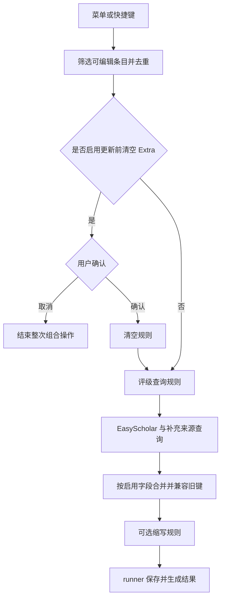

# MetaFlow 与绿青蛙整合：功能、流程与后续工作总表

后续实施状态：迁移校验、快捷键冲突、查询编排、修改计数和自动阶段诊断已继续修复，见 [可靠性修复记录](greenfrog-hardening-2026-10-16.md)。下文保留实施前的分析和施工顺序。

## 1. 当前结论

本地集成版已将新增能力放入 MetaFlow 的规则、菜单、设置和批处理体系，已完成一轮本地功能整合和运行验证。尚不能宣称“完全替代绿青蛙的所有在线功能”：真实密钥、部分旧服务、真实知网抓取和 Zotero 11 仍有验收缺口。

本记录于 2026-10-16 再次核对当前源码、交付清单和安装包 SHA-256。此轮整理未修改业务代码，也未重跑上一轮完整测试。

## 2. 必须分开的三类能力

| 类别 | 输入 | 处理内容 | 写入或展示位置 |
| --- | --- | --- | --- |
| 文章元数据 | DOI、arXiv、PMID、URL；中文标题等 | 获取并核对题名、作者、日期、卷期页码等 | Zotero 对应元数据字段 |
| 期刊和会议评级 | 期刊名或会议名 | EasyScholar 评级、自定义目录及选中的独立补充来源 | 选中的 Extra 键；独立开关控制列表列 |
| 本地整理工具 | 已有条目内容 | 作者标记、姓名交换、大小写、缩写、查找替换等 | 对应字段，由 runner 保存 |

EasyScholar 在当前实现中提供期刊/会议评级，不能把文章元数据服务链也称作 EasyScholar 文章查询。61 个指标是字段定义总数，其中包括 4 项独立来源；19 所大学、11 个自定义数据集已经包含在总数中。

## 3. 功能对照与验收层级

| 模块 | 已实现 | 已有验证 | 未完成或保留的差异 |
| --- | --- | --- | --- |
| 设置页 | 字段、列、自动处理、补充来源、菜单、快捷键设置 | 真实 Zotero 翻译、标签、开关持久化及列注册 | 尚未完成所有设置组合的穷举验收 |
| EasyScholar 解析与写入 | 常规、大学、自定义指标；字段选择；缓存；错误处理 | 单元测试与受控响应 | 未用真实密钥逐字段在线验收 |
| 旧 Extra 兼容 | 六组历史键、SSCI 分区保留、自定义 CCF 补足 | 精确键名回归测试 | 只在对应指标有有效更新时规范化旧键，不主动改写整个文库 |
| 旧偏好迁移 | 密钥、相关开关、部分菜单及五组旧快捷键 | 一次性迁移及新设置优先的单元测试 | 不复制旧默认值、列宽和排序；类型及快捷键冲突校验仍需加强 |
| 作者工具 | 六种加粗/加星动作、姓名筛选、姓名交换 | 真实条目保存及机构作者保护 | 菜单组织与上游不同；复用现有作者大小写规则 |
| 查找替换 | 标题和期刊名；首处/全部；字面替换 | 真实条目和特殊替换文本 | 不支持正则；这是当前明确的产品边界 |
| 清空 Extra | 单独工具及手动更新前可选步骤 | 确认、取消、保存流程 | 自动路径不清空；手动确认清空后，查询失败也不会自动恢复旧 Extra |
| 自动处理 | 元数据补空 → 标准规则 → 可选期刊评级 | 真实新增条目及总开关检查 | 分阶段批次，不能宣称整个自动流程是一笔事务或一次撤销 |
| 中文标题检索 | 无 DOI 的中文标题检索与唯一结果筛选 | Gecko 解析受控 HTML、域名限制及歧义拒绝 | 真实网站访问、验证码和翻译器成功抓取尚未验收 |
| 南农核心 | 2010 历史分类 157 条 | 与固定上游逐条比对及本地查询测试 | 不代表最新目录 |
| 南农高质量 | 独立查询服务 | 网络探测 HTTP 200 | 样例返回 `tag: 0`，缺正向评级样例 |
| 中文复合/综合 IF | 独立代理适配器 | 数值解析、来源失败隔离测试 | 上一轮实际探测超时 |
| 快捷键及目录 | 共 12 个快捷键、两类目录命令 | 注册、录制、冲突处理和输入场景相关测试 | 旧设置导入与设置页的冲突校验尚未统一 |

“已实现”“受控响应测试通过”“真实外部请求成功”是不同验收层级。测试数量不等于绿青蛙功能覆盖率，不应换算成整合百分比。

## 4. 主要流程

### 4.1 手动评级更新

查询失败一般保留未更新指标，但“更新前清空 Extra”是独立、已确认的修改。它执行后，即使所有网络查询失败，清空动作仍可能保存。因此不能将该选项描述为“只清除成功替换的评级”。建议日常使用保持此项关闭。

### 4.2 自动新增处理

新增通知 → 延时聚合 → 总开关/群组/可编辑性筛选 → 可选元数据补空 → 生命周期与开关复查 → 标准规则 → 再次复查 → 可选评级查询。

元数据自动模式固定为“仅补空、不改类型”。三个阶段分别进入 runner；每个阶段有自身保存和结果边界。关闭自动处理总开关会阻止后续阶段，不代表倒回已经保存的前一阶段。

### 4.3 元数据服务链

当前顺序为 arXiv → 标识符翻译器 → 中文标题知网检索 → 条目翻译器 → Semantic Scholar → URL 翻译器。每个服务先检查适用条件；已有足够字段时可以提前结束，并非每个条目均请求全部服务。

返回数据经过规范化和身份校验，再按补空或显式覆盖策略合并；保存仍由 runner 负责。元数据工具目前适用于文章、预印本、会议论文和网页，不能扩展表述为所有 Zotero 条目类型都已支持远程补全。

## 5. 本次源码复核新列出的改进点

以下是源码确认的实现边界及由其产生的风险；本轮没有将它们改写为“已修复”，也没有声称均已做实时故障复现。

| 优先级 | 当前实现 | 影响 | 建议实现与验收 |
| --- | --- | --- | --- |
| P1 | 旧偏好仅检查值属于字符串/布尔/数字之一，未按目标键校验类型 | 异常旧配置可能无法正确导入或在启动时出错 | 给每个目标偏好定义类型，跳过异常值并记录不含密钥的迁移摘要；测试错误类型不影响启动 |
| P1 | 导入旧快捷键时直接组合修饰键和按键 | 可能与 MetaFlow 的其他快捷键冲突；运行时遇到多个匹配会不执行 | 复用规范化与冲突校验；例如旧评级快捷键改成 T 时，不得使默认标题快捷键同时失效 |
| P1 | 评级规则共享 20 秒截止时间，主来源和补充来源全部等待后才合并 | 正常返回的来源在整体超时边界上仍可能来不及写入 | 设计来源独立截止时间和部分结果结算；测试一个来源成功、另一个跨越期限时仍保留成功数据 |
| P2 | 即使所有输出字段关闭，仍会调用 EasyScholar | 无意义地消耗请求额度并等待 | 请求前按启用字段判断所需来源；全部关闭时零网络调用并给出清晰提示 |
| P2 | 自动处理分成多次 runner 调用 | 报告、撤销和定位问题需要区分阶段 | 先明确是否要“一次自动处理一次撤销”；若需要，增加父操作记录，而非强行扩大数据库事务覆盖网络等待 |
| P2 | 更新报告计数来自返回的有效字段数 | 返回 10 项但只改动 1 项时，不能将 10 项理解为实际修改数 | 分别记录命中、启用、实际修改、移除和未变项，并以差异计算修改数量 |
| P2 | 旧外部来源缺正向验收 | 用户可能开启后长期无数据 | 增加可检查的来源状态、数据年份和错误分类；接口替换必须有合法可用的数据源依据 |
| P2 | 缺少字段级来源及查询时间的完整持久记录 | 难以区分旧值、缓存值和当次结果 | 先设计独立来源记录与展示，不默认把实现日志塞进 Extra |

## 6. 工程推进顺序

1. 先修设置迁移：目标类型校验、快捷键规范化与冲突隔离、可读迁移摘要。
2. 再修查询编排：按字段选择来源、无输出零请求、独立截止时间、部分成功保留。
3. 再完善报告：区分返回值和实际修改，明确自动处理的阶段及撤销范围。
4. 分别做在线验收：EasyScholar 真实密钥、南农正向样例、中文 IF 可用来源、知网真实抓取。缺数据或权限时保留明确的未验收状态。
5. 重跑 Zotero 10 与 Zotero 11、最终包安装及关键迁移场景，再整理 Git 提交和发布版本。

每一步先增加针对真实边界的回归用例，再实现修复，最后重新生成安装包。当前清单是后续施工和验收依据，不代表以上事项已经执行。

## 7. 当前代码、包和 Git 的对应关系

| 对象 | 核对结果 |
| --- | --- |
| 根工作副本 | `D:\Dev Studio\Linter for Zotero`，package 10.0.0，提交 `748d041` |
| 当前集成源码 | `.scaffold/publish/metaflow-10.0.1`，package 10.1.0，HEAD `584394b`，有未提交集成修改 |
| 本地交付包 | `artifacts/greenfrog-integrated-2026-10-16/zotero-metaflow-10.1.0-greenfrog-integrated.xpi` |
| 安装包 SHA-256 | `1b85c42620a8a390025268a28e748f9719bf3691a7b55d6e94095bf6fdacba2d` |
| GitHub 发布状态 | 这批本地集成修改尚未提交、推送；不能视为 GitHub 主线已包含 |

功能已经在同一套运行体系中整合，与“所有工作副本和 GitHub 主线都已统一”是两件事。后续应明确唯一维护副本，并在检查根副本既有修改之后再迁移，避免覆盖用户内容。

上一轮结果为 310 项单元测试、61 项完整真实 Zotero 测试、最后 8 项交付包专项测试通过，构建和静态检查通过；61 和 8 包含重复覆盖，不能相加表述为 69 项独立完整 E2E。当前轮仅重新读取证据并核验安装包哈希。

详细实现记录见 `greenfrog-integration-2026-10-16.md`；交付证据见安装包同目录的 `verification.json` 和测试日志。
