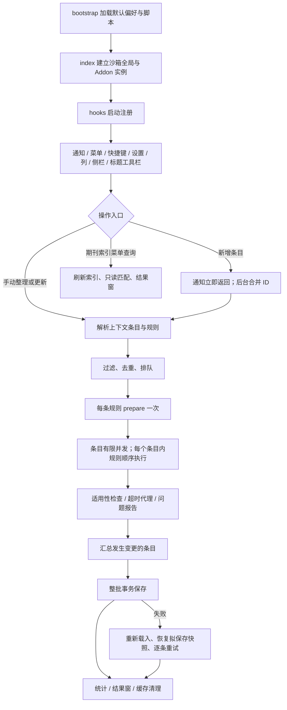

# Zotero MetaFlow 10.0.0：实现流程、问题与优化审查

日期：2026-10-16。对象：当前工作目录 `D:\Dev Studio\Linter for Zotero` 的源码、默认配置、测试和构建流程。

结论：现有架构已经具备规则抽象、统一批处理、失败隔离、事务恢复和实机测试基础。当前最需要投入的是**数据正确性、人工字段保护、规则失败后的状态恢复和联网更新质量**，其次才是增加功能或调整界面。尤其是数字范围误改、启发式清空字段、人工短标题被覆盖，以及失败规则的半成品被提交，均已在本轮独立 Zotero 资料库中复现。

本轮不修改功能源码，不发布安装包，不改动日常资料库。新增审查文档和诊断脚本；构建及测试仅更新 `.scaffold` 下的生成文件。

## 1. 审查方式与证据强度

- **实机复现**：在 Windows Zotero 10.0.6 / Gecko 140 中，使用 scaffold 独立的 `.scaffold/test/profile`、`.scaffold/test/data`，创建临时条目、执行真实规则、保存后重新加载核对。退出后删除测试条目。
- **受控复现**：调用真实规则或执行器，以可控 Zotero 接口和服务响应替代外部环境。证明分支行为，不能据此声称真实第三方服务已经返回错误数据。
- **静态审查**：沿调用链核对实现、配置、异常路径和现有测试。未实际触发的风险明确标出。
- **设计建议**：尚未实施，不能当作现有功能。

本轮运行原有 41 个单元测试文件、257 项测试，全部通过；生产构建及插件 TypeScript 检查通过。`pnpm lint:check` 未通过：ESLint 阶段完成，AutoCorrect 在 `README.zh-CN.md:21` 报一处中英文句间空格问题。

两次完整 Zotero E2E 均为 **49 通过、1 失败**。失败发生在 `menu-native.spec.ts` 等待 MetaFlow 子菜单打开的同一断言，尚未执行到当次索引查询命令；因此不能称为“ESI/Nature Index 匹配失败”。隔离复测该菜单用例时，两项菜单测试通过，索引结果可见。另四项新增实机诊断均成功复现下文缺陷。最终验证表见本报告末尾。

受控诊断：12 项全部通过。这里的“通过”表示复现了断言描述的现有行为，**不表示缺陷已经修复**。

本轮没有重新验收 Zotero 11、macOS、Linux，也没有用实时第三方 API 验证联网更新；`dist/verification.json` 中 2026-10-14 的历史验证不能替代本轮结果。

## 2. 总体调用关系



注意：期刊索引菜单是专用只读路径，不经过统一修改与保存队列。普通规则的默认执行顺序来自注册表；显式传入多个规则时，执行器保留请求顺序。例如更新菜单显式先加入更新工具，再加入启用的标准规则。

## 3. 每个阶段的实际实现

### 3.1 启动和注册

涉及 `addon/bootstrap.js`、`src/index.ts`、`src/addon.ts`、`src/hooks.ts`。

1. Bootstrap 将 `prefs.js` 载入默认偏好分支；建立 `ctx`，注入 `rootURI` 与 `_globalThis`。
2. 加载打包脚本，`index.ts` 检查 `Zotero.MetaRef` 是否已经存在；不存在时注入 Zotero、console、addon，并建立 ztoolkit 全局 getter。
3. `Addon` 构造共享配置、存活标记、工具包、对话框集合以及单例 `LintRunner`。
4. `onStartup` 等待 Zotero 初始化、数据库解锁及 UI 就绪；每个关键等待后检查插件是否仍存活。
5. 按顺序注册语言资源、设置、通知、菜单，读取期刊索引，注册额外列及侧栏，再初始化各主窗口快捷键和标题工具栏。
6. 启动异常会调用统一卸载清理，再抛出原异常。

评价：生命周期与异常清理有基础测试。优化方向是把核心注册与期刊索引预热解耦：当前索引读取完成前，列、侧栏及主窗口初始化需要等待。对于很慢的自定义路径，延迟会向核心 UI 传播。这是静态风险，本轮未测得实际启动卡顿。

### 3.2 新条目自动整理

涉及 `src/modules/notifier.ts`、`src/utils/automatic-items.ts`、`src/hooks.ts`。

1. 注册 item observer；通知回调只派发 Promise 并捕获错误，不让 Zotero 的导入事务等待整理完成。
2. 只接受已开启自动整理的 `add/item` 事件；`extraData.skipAutoSync` 为真时跳过。
3. 将 ID 转为正安全整数，用 Set 去重；等待窗口至少 500 ms、最多 60 s。
4. 到期提取当前待处理 ID；正在处理期间到来的 ID 进入下一批，批次串行派发。
5. 执行前再次检查插件存活、自动开关、条目存在、普通条目、可编辑、未删除、非订阅、非空标题，以及群组开关。
6. 通过 `onLintInBatch("standard", items)` 调用启用的标准规则。

评价：已避免通知阻塞，并处理了执行前偏好变化。500 ms 是缓冲窗口，不能保证所有导入器或其他插件在此时间内完成后续修改。导入期间标题暂为空的条目会跳过，当前没有针对这些条目的有界重试；可考虑仅对已识别导入过程做少量延迟重查，避免对所有 modify 事件反复自动整理。

### 3.3 菜单和快捷键入口

涉及 `src/modules/menu.ts`、`src/modules/shortcuts.ts`、`src/utils/shortcuts.ts`。

1. 条目菜单从 context.items 取条目；分类菜单从 collectionTreeRows 取各行条目，避免误用当前列表选择。
2. 入口根据偏好决定显示，并按类型、可编辑性等决定启用；菜单显示开关与自动规则开关分离。
3. 用 `WeakSet<Event>` 去重同一个 command 事件，处理宿主延迟移除监听造成的重复派发。
4. 更新菜单组装 `[tool-update-metadata, standard]`；日期菜单组装多个日期字段规则。
5. 索引查询走只读专用路径，允许查询不可编辑条目；先刷新数据库，再生成展示结果。
6. 快捷键忽略已消费、重复、输入法组合事件；标题快捷键只作用于标题编辑器，批处理快捷键只作用于条目树选择。
7. 设置中的快捷键录制支持校验、冲突检测、禁用、重置，运行时读取偏好。

评价：入口上下文处理较完整。索引菜单对非期刊普通条目也可能显示为可用，执行时过滤后没有结果窗，应按 journalArticle 限定启用或给“没有适用条目”的反馈。菜单子窗口打开仍存在本轮时序失败，见问题 M11。

### 3.4 统一任务分发和队列

涉及 `src/hooks.ts:onLintInBatch`、`src/modules/runner.ts`。

1. 将字符串来源解析成选中条目或分类子条目。
2. 排除非普通、已删除、不可编辑条目；按条目 ID 去重。
3. `standard` 展开为当前启用规则；明确 ID 获取对应规则；按 ID 去重。
4. 没有条目或规则则直接返回。
5. `runner.add` 复制条目数组和规则数组，用 Promise 链串行排队；上一批拒绝也能继续下一批。
6. 真正执行时再次检查条目有效性；条目对象本身未深复制，排队期间仍指向活的 Zotero 对象。

评价：避免了多个批次同时修改同一条目。但活对象可能同时被用户或其他插件修改；目前缺少“运行基线—拟修改字段—提交前冲突”的比较。建议在长时间联网任务中加入字段级冲突检测，不能直接假设等待前后的对象状态属于同一版本。

### 3.5 规则准备

1. 每条规则先执行一次 `prepare({ items, debug })`，结果放入 optionsMap。
2. 没有 prepare 时使用空对象。
3. 标准规则返回 false 时跳过此规则；工具返回 false 时取消整个组合操作，防止关闭更新对话框后仍继续整理。
4. 准备抛错则报告准备失败，记录数量，将该规则标为 false；其他规则继续。
5. 这些准备在条目 apply 前全部执行，因此准备阶段读取的条目状态可能早于元数据更新结果。

评价：prepare **没有执行截止时间和 AbortSignal**。用户有意停留的设置窗不应强制定时关闭，但数据库查询、文件读取等准备工作需要独立的超时和取消支持。当前 cancel 只设置标记，不能唤醒正在等待的 prepare。

### 3.6 条目处理与规则隔离

1. 读取并规范化并发值为 1–16，启动有限 worker；每个 worker 领取下一个条目。
2. 单条目内依次检查规则选项、类型、忽略类型、目标字段有效性及映射字段。
3. `executeRule` 为本次规则创建 AbortController，以默认 60 s 截止时间执行 Promise.race。
4. 条目 Proxy 拦截常见修改方法及属性写入；超时、失败或正常结束后撤销写权限，阻止晚到回调再写回。
5. 规则级报告关联 itemID、标题和 ruleID；error 计入失败条目。
6. 某一规则抛错后仍继续其他规则，最后统一将该条目标为失败。
7. 只要 live item.hasChanged，就加入待保存集合。

评价：对“结束后才发起的写入”有保护，但**不会撤销规则结束前已经发生的写入**，见 M04。规则成功、条目成功和字段修改成功也没有分别建模；不适用任何规则的条目可能仍计为 passed，应增加 no-op、not-applicable、changed、warning 等维度。

### 3.7 事务保存与恢复

1. 从待保存集合提取条目，并保存 `toJSON()` 快照；这是**全部规则执行后的拟保存状态**。
2. 在一个数据库事务中逐条调用 item.save，跳过已无变更的条目。
3. 成功后记录实际保存数，并尽可能登记整批撤销动作。
4. 事务失败后，逐条重新载入数据库字段、恢复拟保存快照，再调用 saveTx 重试。
5. 单条永久失败报告 item-save 并计入失败；其他条目继续。

评价：事务失败恢复是现有实现的优点，本轮原有实机用例通过。但该快照用于“恢复本批结果后重试”，**不是恢复规则前原始值**，不能解决 M04。建议保留原始基线和规则拟修改内容两份状态，并分别规定规则失败、保存失败、用户取消的行为。

### 3.8 取消、卸载、统计和结果窗

1. cancel 设置标记；worker 不再领取新条目，条目不再开始下一规则。
2. 已开始的规则继续，完成后仍提交已产生的修改；当前取消语义是“停止后续工作”。
3. `finally` 中生成 lastResult：总数、已处理、通过、失败、保存、取消、跳过、准备失败和报告记录。
4. 清理自定义数据批次缓存，保留内置资源及派生索引；重置统计状态。
5. 进度同阶段最多每 100 ms 刷新；阶段切换及完成强制刷新。
6. 非静默且有记录时打开报告；报告以 textContent 显示文本，避免将元数据直接作为界面 HTML。
7. 卸载先设置 alive=false，取消待派发自动任务、解除通知、关闭设置窗和报告，再等待 runner，最后清理注册资源与全局实例。

评价：取消后依然保存是已有文档说明的设计，不能直接按缺陷处理；界面应明确“已完成的修改仍会保存”。报告目前只展示问题，不提供逐字段前后对照、来源或导出；大量问题全部生成 DOM，也缺少分页。建议先补可追踪修改记录，再考虑批量界面的性能优化。

## 4. 49 项规则与工具的逐项检查

注册顺序见 `src/modules/rules/index.ts`。共 **40 项标准规则、9 项手动工具**。下表“默认”指自动标准规则偏好，不代表所有类型都会执行；工具始终手动触发。

| 顺序 | 规则 ID | 实际实现 | 默认及重点检查 |
| --- | --- | --- | --- |
| 1 | no-item-duplication | 每库准备重复条目 ID 集合；命中报告并提供打开重复列表动作 | 开；每批查询涉及资料库，尚无跨批失效缓存 |
| 2 | no-article-webpage | 按出版商域名识别可能被存成网页的论文；报告并提供更新动作 | 开；只警告，不直接改类型 |
| 3 | no-journal-preprint | 提取 DOI、archiveID、URL，识别期刊条目中的预印本线索 | 开；历史预印本 URL 与正式 DOI 共存可能需要人工判断 |
| 4 | no-value-nullish | 全部已用字段中清空 null、none、n/a 等词及“无” | 开；会清空合法标题 None，见 M02 |
| 5 | no-field-misuse | 按中英文、emoji、分区和数字模式清理短标题及档案等字段 | 开；没有可靠来源识别，见 M02 |
| 6 | require-language | 标题经 tinyld 判断语言；可限制语言集合 | 开；默认不保留已有合法语言，建议人工值优先 |
| 7 | no-title-trailing-dot | 去掉标题单个尾点，保留省略号 | 开；结尾缩写的点仍可能被视为句点，需增加真实样本 |
| 8 | correct-title-punctuation | 规范连字符、冒号前空格，可选引号转换；支持映射字段 | 开；包含数学减号到连字符的转换，科学标题宜预览 |
| 9 | correct-title-sentence-case | 句式大小写、标记保护、术语替换、语言排除 | 开；启发式不能证明专名或科学符号含义 |
| 10 | correct-title-chemical-formula | 完整词元解析元素、括号、计量比与电荷，输出 sub/sup | 关；保留默认关闭，C4 等语义歧义需要人工控制 |
| 11 | require-short-title | 从“冒号 + 空格”前提取主标题；已有非前缀短标题仍覆盖 | 开；实机确认覆盖人工值，见 M03 |
| 12 | correct-shortTitle-sentence-case | 对 shortTitle 使用同一大小写与术语流程 | 开；应与人工短标题保护联动 |
| 13 | require-creators | 没有任何 creator 则报告错误 | 开；不会检索作者，也不区分某些类型的合理缺省 |
| 14 | correct-creators-punctuation | 作者姓名规范连字符与中点，最后统一 setCreators | 开；保留机构/个人字段模式，仍应覆盖国际姓名样本 |
| 15 | correct-creators-case | 规范全大写/全小写姓名；全大写机构名保留 | 开；国际复姓、粒子和品牌机构名需要保护样本 |
| 16 | correct-creators-pinyin | 有限拼音分词，排除已带分隔及部分西文名 | 关；无法仅凭拼写可靠区分所有姓名，维持可选 |
| 17 | correct-date-format | Zotero.Date.strToISO 后写 date | 开；需要保留无法可靠解析的原值与日期精度 |
| 18 | correct-extra-order | Citation Key、内置字段、original-* 等排序，保留非标准部分 | 开；可将字段名小写集合移出排序比较器 |
| 19 | require-doi | DOI 为空且非中文时，用 OpenURL 查询 Crossref；多解只警告 | 开；联网、15 s 请求超时；resolved 后未做二次作品一致性校验 |
| 20 | no-doi-prefix | cleanDOI 去前缀 | 开；本地操作 |
| 21 | correct-doi-long | doi.org Handle API 解析短 DOI 或检验长 DOI；保留 short-doi | 开；每次有 DOI 都可联网，缺少结果缓存和独立请求超时 |
| 22 | correct-publication-title-alias | 内置标题正规化键映射到首个标准标题 | 开；正规化碰撞应审计并标歧义 |
| 23 | correct-publication-title-case | 内置标准刊名直接保留，其余按词及缩写表转大小写 | 开；品牌、连字符专名依赖词表和原大小写 |
| 24 | require-journal-abbr | 自定义映射→内置映射→在线 LTWA 推断→可选全称 | 开；infer 默认开，已有缩写在找到替代值时会覆盖 |
| 25 | correct-pages-connector | 各连接符、空格、加号转统一页码连接格式 | 开；没有完整解析文章编号语义 |
| 26 | correct-pages-range | 对 1–3 位正整数起始页，根据最佳 PDF 总页数补范围 | 关；PDF 可含封面和 SI，总页数只能作推断 |
| 27 | no-issue-extra-zeros | 使用共用 removeLeadingZeros 规范 issue | 开；错误修改以 0 结尾的范围首数，见 M01 |
| 28 | no-pages-extra-zeros | 同一函数规范 pages | 关；同 M01，尤其会直接改页码 |
| 29 | no-volume-extra-zeros | 同一函数规范 volume | 开；同 M01 |
| 30 | correct-conference-abbr | 自定义/内置匹配会议名或论文集名；去届次后再试；写 Extra | 开；保留主字段，注意额外字段来源和碰撞 |
| 31 | correct-proceedingsTitle-sentence-case | 论文集名套用标题规则 | 关；与标准刊名/会议名语义不同，保持独立开关 |
| 32 | correct-thesis-type | 硕士/博士等类型规范化 | 开；类型子串映射应覆盖复合学位及英文样本 |
| 33 | correct-university-punctuation | 中文学校名称中的括号转全角 | 开；语言或学校汉字判别 |
| 34 | require-university-place | 按学校映射查地点，带括号时尝试去括号 | 开；映射命中会覆盖人工地点，多校区需谨慎 |
| 35 | correct-edition-numeral | 英文序数、罗马数、中文数及版次别名规范化 | 开；限 book；混合描述需要语义样本 |
| 36 | correct-volume-numeral | 同上，作用 volume | 开；限 book，与期刊 volume 去零不同 |
| 37 | correct-bookTitle-sentence-case | bookTitle 套用标题规则 | 开；受目标字段有效性检查 |
| 38 | correct-filing-date-format | filingDate 转 ISO | 开；限 patent |
| 39 | correct-issue-date-format | issueDate 转 ISO | 开；限 patent |
| 40 | correct-priority-date-format | priorityDate 转 ISO | 开；限 patent，依赖新宿主字段 |
| 41 | tool-query-esi | 准备 ESI 索引并计算，规则本体主要写调试日志 | 手动；菜单另走专用可见报告路径，存在路径分叉 |
| 42 | tool-title-guillemet | 设置窗选择《》与〈〉的转换方向 | 手动；对话框仍有硬编码英文 |
| 43 | tool-creators-ext | 备份作者扩展到 Extra，可加入国籍标记 | 手动；限制单条；姓名语义与兼容性需人工确认 |
| 44 | tool-set-language | 从列表或输入值设置 language | 手动；自由输入缺少规范化验证，随后常规自动判断可能覆盖 |
| 45 | tool-update-metadata | 标识符提取、补充、按顺序取首个可用结果，再应用类型/作者/字段 | 手动；详见第 5 节 |
| 46 | tool-get-short-doi | shortdoi.org 请求；写 Extra.short-doi | 手动；已有值跳过，缺少独立请求截止时间和共享缓存 |
| 47 | tool-query-nature-index | 准备索引、识别名单内期刊，规则本体主要写日志 | 手动；与菜单展示路径应合并 |
| 48 | tool-csl-helper | 提供 original-* 翻译辅助并合并 Extra，再排序 | 手动；单条；不应推断未经核实的人工译名 |
| 49 | tool-clean-extra | 收集所选条目的 Extra 字段，用户勾选后删除 | 手动；保留明确选择，适合增加变更预览 |

## 5. 联网元数据更新的完整流程

涉及 `src/modules/rules/tool-update-metadata/`。

1. **设置准备**：默认覆盖模式 all、允许类型变更，通常弹窗确认；silent 偏好开启时直接用默认值。建议默认 blank，覆盖作为明确选择。
2. **提取标识符**：DOI 主字段优先，其次 Extra、URL；提取预印本来源、PMID、PMCID、ISBN、Semantic Scholar ID 等。
3. **标识符补充**：先选出适用服务。arXiv 尝试取得正式 DOI；Semantic Scholar 对预印本或会议论文补充 DOI/自身 ID。某一服务返回 true 就停止标识符补充。
4. **重新判定服务资格**：补充标识符后再次调用 shouldApply，保证新得到的 DOI 可用于后续转换器。
5. **取数据**：顺序为标识符转换器→原条目转换器→Semantic Scholar→网页转换器；arXiv 服务本身没有 fetch，只补标识符。转换器设置 `libraryID:false` 避免创建新条目。
6. **有效性清洗**：normalizeMetadata 丢弃非字符串字段及结构不合规作者；只要 title、DOI、刊名、date 中任一存在，或存在作者，就认为返回可用。
7. **服务选择**：第一个可用响应立即结束后续服务尝试；不是逐字段合并，也不是完整度比较。
8. **类型应用**：合法类型且允许变更时可 setType；blank 模式明确禁止破坏性类型迁移。all 模式中没有逐字段丢失预览。
9. **作者应用**：blank 模式有原作者就保留；检查 creatorType 对目标类型有效性；有非法角色则整组不应用并警告。
10. **字段应用**：只写目标类型有效字段；blank 跳过非空旧值；拒绝非法 accessDate，abstractNote 压缩空白；不以空响应覆盖原值。
11. **继续常规整理**：菜单会接着跑启用标准规则。因此更新 blank 并不等于整个组合任务不改已有字段，见 M08。
12. **保存报告**：与其他规则共用 runner；部分服务失败后成功回退会给 warning，完全失败给 error。

已有优点：区分 PMID/PMCID、服务资格重新判断、非法结构过滤、blank 不迁移类型、错误回退、服务节流、统一保存。

主要缺口：没有作品身份一致性校验；首个稀疏响应截断后续补齐；Semantic Scholar 请求了 authors 但 transform 明确返回 `creators:undefined`；404 在宿主默认 HTTP 行为下抛异常，可能提前退出同一服务内部的多标识符循环；当前取消信号主要拦截写回，没有普遍中止底层请求。

## 6. 已确认的问题及优先级

优先级含义：P1 为可能直接改错或丢失用户元数据，建议下一轮先修；P2 为流程正确性、可解释性和稳定性问题；P3 为维护与文字问题。此处没有发现可据本轮证据认定的 P0。

### M01 / P1：去零函数误改合法数字范围

- 位置：`src/modules/rules/no-extra-zeros.ts:6`。
- 原因：去零后无条件执行 `.replace("0-", "1-")`，未约束为起始页恰好为零。
- 复现：`10-12 → 11-12`，`20-25 → 21-25`，`100-110 → 101-110`。
- 影响：共用于 issue/pages/volume；issue 与 volume 默认开。实机确认原本 `volume=10-12, issue=20-25` 保存后变成 `11-12, 21-25`。
- 修复建议：把通用前导零规范化与“起始页为零”的业务判断分开；不要对 issue/volume 套页码纠正。是否允许将 0 页改成 1 页也应单独决策。
- 验收：10、20、100 结尾范围不变；前导零按预期去除；页码、卷号、期号分别覆盖；二次执行不再变化。

### M02 / P1：启发式清空无法区分人工有效值

- 位置：`no-field-misuse.ts:38,69`、`no-value-nullish.ts:34`。
- 复现：档案编号 `Q1` 被清空；英文标题配中文短标题被清空；标题 `None` 被当作空值清空。Q1 清空已实机保存验证，另两项为受控复现。
- 原因：字符形态被直接当作“某插件写入”的来源证据；None 等文本未按字段语义分类。
- 修复建议：明确占位符按字段白名单清理；短标题、档案编号、索书号等歧义值默认只报告。要清理外部插件数据，应有明确来源特征或人工选择，并提供原值预览。
- 验收：人工 Q1、数值型档案号、双语短标题和合法 None 标题保留；可确定的占位符仍能识别。

### M03 / P1：require-short-title 会覆盖非前缀人工短标题

- 位置：`require-short-title.ts:27–33`。
- 复现：title=`A long title: Subtitle`，shortTitle=`Curated abbreviation`，执行后短标题变为 `A long title`；已实机保存验证。
- 原因：只有“现有短标题刚好是完整标题的前缀”才跳过，不是“现有非空值就跳过”。代码注释与实际保护范围也不一致。
- 修复建议：require 默认仅补空；另设手动“根据主标题重建”操作或显式覆盖选项。同步约束后续短标题大小写规则。

### M04 / P1：失败或超时规则的中途修改仍被保存

- 位置：`runner.ts:263–298,301–306`、`utils/rule-execution.ts`。
- 复现：规则先 setField，再抛异常；结果 `failed=1, saved=1`，数据库保留半成品。已实机保存并 reload 验证。先写后超时也已受控复现。
- 关键区别：允许保存健康兄弟规则的修改是合理设计；当前连失败规则自己的未完成修改也被保留。
- 修复建议：每条规则生成字段变更计划，成功才合并；或规则前快照、失败恢复到该规则开始前状态。恢复时保留更早已成功规则的修改。不能用“失败则整条目回滚”简单替代，否则会丢弃健康规则结果。
- 验收：先写后抛错、先写后超时、类型改到一半、作者改到一半；兄弟规则仍执行并保存；晚到写回仍被拒绝。

### M05 / P2：元数据响应没有作品身份一致性校验

- 位置：`tool-update-metadata/index.ts:104–108,316`。
- 受控复现：条目 DOI 为 `10.1234/original`，服务返回另一个 DOI 和标题，all 模式直接应用。
- 边界：这证明缺少校验，不证明本轮某真实服务错配。
- 建议：比较规范化 DOI；无 DOI 时综合标题、首位作者、年份、来源。预印本转正式版本属于允许的特例，需要可解释的关联证据。低可信候选只展示，不自动覆盖。

### M06 / P2：稀疏响应导致过早结束，缺字段不再补齐

- 位置：`tool-update-metadata/index.ts:104–108,332`。
- 受控复现：第一个服务只返回原 DOI，也被认为成功；后续含年份等信息的服务调用次数为零。
- 建议：按本次需求定义完成条件；blank 模式只针对仍缺失的字段继续补齐，记录字段来源与冲突。不能为了完整度盲目合并身份不同的候选，应先完成 M05。
- Semantic Scholar 作者当前刻意不拆分，是已有实现限制。可优先使用结构化作者来源；对只有全名的数据保留机构和姓名歧义，不建议直接按最后一个空格切分。

### M07 / P2：Semantic Scholar 的单服务多标识符回退会被 404 中断

- 位置：`semantic-scholar-service.ts:57–60`。
- 原因：循环内 await request；HTTP.request 默认对非 2xx 抛异常，代码中 `_status !== 200` 分支不能普遍处理该情况。外层会切换到其他服务，但不会继续本服务循环中的下一个标识符。
- 受控复现：arXiv 请求拒绝 404 后，已有 URL 没有被尝试。宿主行为也与项目保留的 HTTP 实现相符。
- 建议：在单次标识符请求处区分 404/无匹配、429、网络失败和取消。无匹配可继续；429 遵循退避；不能把取消当作普通失败吞掉。

### M08 / P2：blank 更新和后续整理的修改承诺不一致

- 位置：`menu.ts:157–159` 的组合规则构造，及 M03。
- 受控复现：更新步骤保留已填字段，后续 require-short-title 仍覆盖现有短标题。
- 边界：菜单名称和流程文档已经说明会接着整理，因此属于选项范围不清晰及人工字段保护问题，不能单独认定所有整理都是错误。
- 建议：在操作中分别选择“仅补缺失元数据”和“随后运行常规整理”，预览最终变更；至少让对话框明确 blank 仅作用于联网获取步骤。

### M09 / P2：prepare 等待无法被 cancel 及时结束

- 位置：`runner.ts:107,208`。
- 受控复现：prepare 持续 pending；cancel 后批次仍不结束，只有释放准备 Promise 后才退出。
- 建议：准备上下文加入 signal；对文件/数据库/网络工作设可取消截止时间，对用户设置窗口使用显式关闭取消。卸载关闭对话框已有保障，但不能覆盖所有准备工作。

### M10 / P2：无选区时插入空格式标签

- 位置：`rich-text.ts:396`。
- 受控复现：MoS2 的光标放在 2 前，无选区执行下标，得到 `MoS<sub></sub>2`。
- 与 `docs/metadata-workflow-zh.md` 中“未选择文字时不插入空标签”不一致。
- 建议：无选区时不修改，工具栏相应禁用或给轻量提示；如果产品决定支持插入标签，需明确其输入与退出行为，并修正文档与快捷键语义。

### M11 / P2：原生菜单子菜单打开存在本轮时序失败

- 证据：两次全量均为 49/50，同一用例失败；日志为 `MetaRef popup opening must complete; tracked=[]`，对应 `test/tests/menu-native.spec.ts:59`。这是本轮完整测试顺序下重复出现的问题，不能仅按一次偶发失败忽略。
- 隔离复测：同一菜单两项用例通过，并完成 ESI/Nature Index 三轮查询；新增实机缺陷诊断四项也通过。
- 尚不能确定：宿主 focus/popup 事件时序、测试之间窗口影响，或插件入口问题。
- 建议：记录 popupshowing/popupshown/popuphidden、焦点窗口、root.open、popup.state、关联 command；以宿主事件而非仅轮询赋值等待来定位。不得把隔离通过改写成首次全量通过。

### M12 / P3：质量门禁和维护项

- AutoCorrect 当前在 README 第 21 行失败；这是文字格式问题，不能说当前 lint 全绿。
- `vitest.config.ts` coverage.include 仅覆盖 `src/modules/rules/*.ts`，没有 runner、hooks、数据缓存、设置和嵌套元数据服务。测试会运行，但覆盖率百分比不能代表这些模块。
- 本轮曾把单文件路径传给 scaffold 的 test.entries；脚手架按目录拼接 glob，结果“0 passed”仍以成功退出。随后改为目录入口，才实际运行六项实机诊断；0 项结果不计入本报告通过数。建议测试脚本对空集合和预期测试数量设置门禁。
- require-short-title 单测只测 split 函数，没有验证“已有人工值不应覆盖”；去零单测缺少 10/20/100 结尾范围。这解释了 257 项通过仍漏出核心缺陷。
- 若干工具设置和错误消息仍硬编码中英文；报告直接显示 ruleID，建议统一 Fluent 本地化及用户可读规则名。
- `defineService` 在定义时读取 cooldown；Semantic Scholar 动态 getter 的值在创建节流器时被固定。运行时新增 Token 后不会立即改变节流间隔；建议配置变化时重建调度器。
- 服务支持类型字段仍标记未实现；ESI/Nature 工具规则与菜单可见结果路径分离，维护时容易只修一侧。建议保留一个查询服务、多个薄入口。
- 发布工作流只匹配小写 `v**`，当前历史 V10 是大写标签；未来若继续用大写标签，自动发布触发规则需同步。这里只做本地配置核对，不声称当前 GitHub 工作流运行状态。

## 7. 可以保留的设计与应如何优化

### 第一轮：修数据正确性

1. 修复 M01 范围数字误改。
2. 将 M02 歧义清理改为只报告，保护人工字段。
3. 修复 M03 短标题覆盖，并增加“只补空”的真实规则测试。
4. 为 M04 建立规则成功后提交变更的边界。
5. 对上述变更加实际 Zotero 保存、reload、撤销/重做回归。修复前先建立应当失败的缺陷测试，修复后改为保护正确结果。

### 第二轮：让联网更新可信、可解释

1. 元数据候选加入身份验证、字段来源及差异列表。
2. 身份一致后做缺字段补齐，明确服务优先级和冲突策略。
3. 将 404、429、超时、用户取消分类，统一请求截止时间和重试策略。
4. 明确更新与后续整理两步的选项范围，类型迁移展示将失去的字段。
5. 对 DOI 校验、缩写推断按规范化查询键共享进行中的请求，增加有期限的结果缓存和失败重试策略。

### 第三轮：执行流程与诊断

1. prepare 支持取消；保留用户主动操作设置窗的时间自由。
2. 结果增加 changed/unchanged/not-applicable/warning/failed、规则来源和保存失败原因。
3. 增加可导出的逐字段变更记录，并提供只检查、预览后应用的模式。
4. 为队列提供等待数量和合并重复手动任务的反馈。用户短时间重复点击时不能只靠无上限排队。
5. 定位 M11 的原生菜单事件时序，保留全量与隔离的独立结论。

### 第四轮：有测量依据的性能工作

- 保留现有内置索引缓存、同请求共享、有限 worker 和进度节流，不建议一味提高并发。
- 大资料库重点测重复检索 prepare、外网等待、事务持有时间和报告 DOM，而不只测单纯 setField。
- 重复检索可按资料库缓存，并由新增、修改、删除通知失效；必须先定义与宿主重复检测的一致性。
- 自定义标题术语可在 prepare 编译正则，避免对每条目、每字段重复构造；保存搜索模式和 flags，避免 g 正则 lastIndex 污染。
- Extra 字段排序可复用小写 Set；期刊别名正规化碰撞应输出清单，而不是静默取首个。
- 索引菜单目前每次清除全部 DataLoader 缓存；可分离“查询”和“重新读取数据库”，减少连续查询时重复加载与其他缓存失效。
- 当前批次在所有条目处理完才统一保存；超大规模任务可考虑分段提交，但必须明确整批撤销、取消和部分失败语义，不宜直接切块替换。

## 8. 建议的验收矩阵

| 层次 | 必测场景 | 判定标准 |
| --- | --- | --- |
| 纯函数 | 合法数字范围、前导零、短标题、保护标记、重复执行 | 正确且幂等 |
| 规则状态 | 先写后抛错、超时、作者与类型部分更新 | 失败规则不提交，健康规则保留 |
| 组合任务 | blank+standard、取消工具窗、prepare 挂起、重复点击 | 选项语义清楚，无意外覆盖，无悬挂 |
| 元数据 | 错 DOI、预印本关联、稀疏响应、非法作者、404/429/超时 | 身份可信，回退可解释，来源可追溯 |
| 真实宿主 | 保存后重载、事务回滚、撤销重做、原生菜单、停用重启 | 数据库与 UI 行为一致 |
| 性能 | 小批次、160 条、大资料库、慢文件、离线、并发 1/4/16 | 分段耗时和资源指标明确 |
| 发布包 | 同一 XPI 安装、冷启动、设置保留、更新 | 验证记录绑定包散列和宿主版本 |

## 9. 本轮诊断文件与复现方法

诊断目录：`.scaffold/audit-2026-10-16/`。

- `probes.test.ts` / `vitest.config.mts`：12 项受控当前行为诊断。
- `observations.json`：结构化输入、输出与统计。
- `native-probes.spec.ts`：4 项真实数据库缺陷复现。
- `native/index.spec.ts`：原有两项菜单用例与四项缺陷诊断的隔离入口。
- `e2e-zotero10.log`：首次完整回归，49 通过、1 失败。
- `focused-zotero10.log`：隔离菜单与实机诊断，6 通过。
- `e2e-zotero10-repeat.log`：完整回归复测日志。

受控诊断命令：

```powershell
pnpm exec vitest run --config .scaffold/audit-2026-10-16/vitest.config.mts
```

独立 Zotero 诊断命令；以下设置仅作用于当前 PowerShell 进程，scaffold test 固定使用项目内测试 profile/data，不使用日常资料库：

```powershell
$env:ZOTERO_PLUGIN_ZOTERO_BIN_PATH='C:\Program Files\Zotero\zotero.exe'
$env:METAREF_TEST_PLATFORM='140'
$env:METAREF_TEST_ENTRIES='.scaffold/audit-2026-10-16/native'
$env:ZOTERO_PLUGIN_KILL_COMMAND='pwsh -NoProfile -Command "exit 0"'
pnpm exec zotero-plugin test --no-watch
```

恢复全量入口时先清除 `METAREF_TEST_ENTRIES`，再执行 `pnpm test:e2e`。这里只执行 test，不应把测试专用路径作为日常开发/资料库路径使用。

## 10. 最终验证记录

| 检查 | 本轮结果 | 说明 |
| --- | --- | --- |
| 原有单元测试 | 257/257，41 文件 | `pnpm test:unit` |
| 生产构建及插件类型检查 | 通过 | `pnpm build`，完整 E2E 中也执行 |
| E2E 测试源码类型检查 | 通过 | `pnpm exec tsc --noEmit -p test/tsconfig.json` |
| ESLint | 通过 | lint:check 的第一阶段完成 |
| AutoCorrect | 失败 | 原有 README.zh-CN.md 第 21 行 |
| Zotero 10 全量第一次 | 49 通过、1 失败 | 原生子菜单打开等待失败 |
| Zotero 10 全量第二次 | 49 通过、1 失败 | 同一位置再次失败 |
| 原生菜单隔离复测 | 2/2 | 包含连续三轮 ESI/Nature Index 查询 |
| 新增真实数据库缺陷诊断 | 4/4 复现 | 范围、档案号、短标题、失败规则中途写入 |
| 新增受控缺陷与边界诊断 | 12/12 复现 | 断言当前不理想行为，并非修复验证 |
| Zotero 11 / 其他操作系统 | 本轮未运行 | 不沿用历史通过数作为本轮结论 |
| 实时外部元数据服务 | 本轮未验收 | 服务响应路径以受控测试为主 |

性能用例第二次测得：160 个真实测试条目；八轮缩写索引处理合计 406 ms；内置期刊文件读取一次；自定义单条修改规则加批量保存 593 ms；进度刷新八次；16 个近邻通知合并成一批，耗时 556 ms，其中包含配置的缓冲等待；通知派发测得 80 ms。该测试中部分派发路径使用了受控替代，不能将这些时间理解为全套标准规则、真实外网或真实完整导入的耗时，也不能据此推算大型资料库表现。性能快照见诊断目录 `performance-zotero10.json`。

本轮没有修复上述缺陷。建议先完成 M01–M04，再扩充联网更新和交互功能；即使既有测试全部通过，也应保留新增失败模式的回归断言。

后续已进入实施阶段，修复内容与新验证结果见 [工程修复记录](repair-implementation-2026-10-16.md)。本页保留审查阶段的原始结论。
